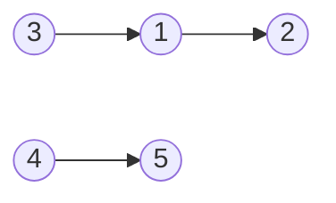
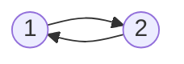
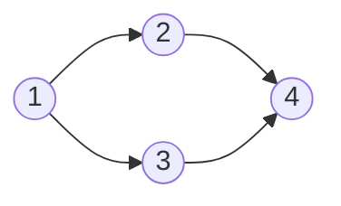

# Course Schedule (Topological Sort)

- CSES 1679: https://cses.fi/problemset/task/1679
- LeetCode 210 (Course Schedule II): https://leetcode.com/problems/course-schedule-ii/description/

- Difficulty: Medium
- Topics: Graph, Directed Acyclic Graph (DAG), Topological Sort, Breadth-First Search, Queue
- Discussed: [Week 12, Day 1](../../weekly_material/week12_day1.md)

## Summary

You are given $n$ courses and a list of dependencies. Each dependency specifies that one course must be completed before another course can be taken.

- In CSES 1679: A pair $(a, b)$ means course $a$ must be completed before course $b$ ($a \to b$). Output any valid completion order of courses (1 to $n$), or `IMPOSSIBLE` if no valid order exists.
- In LeetCode 210: A pair `[a, b]` means course $b$ must be taken before course $a$ ($b \to a$). Return any valid ordering of courses (0 to $n - 1$), or an empty array `[]` if impossible.

## What is a Topological Sort?

A topological sort of a directed graph is a linear ordering of its vertices such that for every directed edge $u \to v$, vertex $u$ appears before vertex $v$ in the ordering.

A graph has a topological sort if and only if it is a **Directed Acyclic Graph (DAG)**. If the graph contains a directed cycle (e.g. $A \to B \to C \to A$), no topological sort can exist.

## Kahn's Algorithm (BFS via In-Degrees)

Kahn's algorithm builds the topological ordering from left to right using a greedy peeling strategy:

1. Calculate the in-degree (number of incoming edges) for every vertex.
2. Push all vertices with `in_degree[u] == 0` into a queue. These are courses that have no remaining prerequisites.
3. While the queue is not empty:
   - Pop vertex $u$ from the front of the queue and append it to our topological order.
   - For every outgoing edge $u \to v$:
     - Decrement `in_degree[v]` by 1 (simulating the completion of prerequisite course $u$).
     - If `in_degree[v]` reaches 0, push $v$ into the queue.
4. If the number of processed vertices equals $n$, return the ordering. Otherwise, a cycle exists (output `IMPOSSIBLE` or `[]`).

## Correctness: The Exchange Argument and Cycle Detection

### 1. Does Every Finite DAG Have an In-Degree 0 Vertex?
- **Proof:** Suppose for contradiction that every vertex in a finite DAG has in-degree $\ge 1$. Start at any vertex $v_1$ and follow an incoming edge backwards to $v_2$, then $v_3$, and so on. Because the graph has a finite number of vertices ($n$), by the Pigeonhole Principle you must revisit some vertex within $n$ steps. Reconstructing the forward edges of that sequence yields a directed cycle, contradicting that the graph is acyclic. Therefore, every finite DAG has at least one vertex with in-degree 0.

### 2. The Greedy Choice Property (Exchange Argument)
When multiple vertices have in-degree 0, Kahn's algorithm greedily chooses any of them to place next. Why does this greedy choice never ruin our ability to complete a valid topological sort?

- **Claim:** If there exists a valid topological sort $O$ for the current graph, and $u$ has in-degree 0 in the current graph, then there exists a valid topological sort $O'$ whose first element is $u$.
- **Proof via Exchange Argument:**
  - Let $O = [v_1, v_2, \dots, v_k, \dots, v_n]$ be any valid topological sort of the graph.
  - If $v_1 = u$, then $O$ already starts with $u$, and we are done.
  - Otherwise, $u$ appears at some index $k > 1$:
    $$O = [v_1, \dots, v_{k-1}, u, v_{k+1}, \dots, v_n]$$
  - Construct a new order $O'$ by moving $u$ to the very front:
    $$O' = [u, v_1, \dots, v_{k-1}, v_{k+1}, \dots, v_n]$$
  - Let us verify that $O'$ is still a valid topological sort:
    - The relative ordering of every pair among $\{v_1, \dots, v_{k-1}, v_{k+1}, \dots, v_n\}$ is unchanged, so all edges between them remain satisfied.
    - The only edges that could possibly be violated are incoming edges to $u$ from vertices that were placed before $u$ in $O$ (i.e. edges $v_i \to u$ for $1 \le i < k$).
    - However, $u$ has in-degree 0 in the current graph, meaning **no vertex points into $u$**! There are zero edges of the form $v_i \to u$.
    - All edges connected to $u$ are outgoing edges ($u \to w$). Since $u$ is now at the very beginning of $O'$, all its outgoing edges point forward, which is completely valid.
  - Therefore, $O'$ is a valid topological sort that begins with $u$.
  - Greedily placing any 0-in-degree vertex next preserves the ability to reach a valid ordering.

### 3. Inductive Step: Graph Shrinkage and DAG Invariant

We formalize the inductive argument on the number of vertices $n$:

- **Base Case ($n = 1$):** A single vertex with no self-loops trivially has in-degree 0. It is placed into the order, satisfying all dependencies.
- **Inductive Hypothesis:** Assume Kahn's algorithm correctly outputs a valid topological sort for any DAG containing fewer than $n$ vertices.
- **Inductive Step (for $n$ vertices):**
  1. By Step 1, graph $G$ has at least one vertex $u$ with `in_degree == 0`.
  2. By the Exchange Argument (Step 2), placing $u$ first is guaranteed to be safe and extendable to a valid topological sort.
  3. When Kahn's algorithm processes $u$, it removes $u$ and all its outgoing edges $u \to v$ from the graph:
     - For each neighbor $v$, removing the directed edge $u \to v$ decrements `in_degree[v]` by 1.
     - This simulates that prerequisite $u$ has been completed, potentially freeing up new vertices whose in-degrees now reach 0.
  4. Let the resulting remaining subgraph be $G' = G \setminus \{u\}$.
  5. **Why must $G'$ remain a valid DAG?**
     - Deleting vertices and edges can never create new cycles. If $G'$ contained a cycle, that cycle must have already existed in $G$, which contradicts our premise that $G$ is acyclic.
     - Therefore, $G'$ is guaranteed to remain a valid DAG on $n - 1$ vertices.
  6. By the inductive hypothesis, Kahn's algorithm correctly produces a valid topological sort for $G'$, say $[v_2, v_3, \dots, v_n]$.
  7. Prepending $u$ produces $[u, v_2, v_3, \dots, v_n]$, which is a valid topological sort for the entire $n$-vertex graph $G$.

### 4. Cycle Detection
If the queue becomes empty while fewer than $n$ vertices have been added to the order, all remaining vertices must have in-degree $\ge 1$. As proven in step 1, a graph where every vertex has in-degree $\ge 1$ contains a cycle, meaning no valid topological sort exists.

## Hints

<details>
<summary>Hints</summary>

1. What kind of course can you take first? A course that has zero prerequisites!
2. Once you complete a course, what changes for the courses that depended on it? Their number of unfinished prerequisites drops by 1.
3. Track an array `in_degree` where `in_degree[i]` is the number of prerequisites remaining for course `i`.
4. Put all courses with `in_degree == 0` into a queue.
5. Pop from the queue, append to your answer, and decrement the `in_degree` of all dependent courses. If any dependent course reaches `in_degree == 0`, push it to the queue.
6. If the output length is less than $n$, a circular prerequisite loop exists.

</details>

## Visual Examples and Test Cases

<details>
<summary>Examples, Diagrams, and Test Inputs</summary>

You can paste the edge list directly into the [CS Academy Graph Editor](https://csacademy.com/app/graph_editor/) (set graph type to directed) to visualize course dependencies.

### Example 1: Valid DAG with Multiple Branches (CSES Sample)



- **Input:**
  ```text
  5 3
  1 2
  3 1
  4 5
  ```
- **Expected Output:**
  ```text
  3 4 1 5 2
  ```
- **Explanation:** Courses 3 and 4 have in-degree 0; taking 3 unlocks 1, taking 1 unlocks 2, and taking 4 unlocks 5 (any valid topological order such as `4 3 1 5 2` is also accepted).

---

### Example 2: Directed Cycle (Impossible)



- **Input:**
  ```text
  2 2
  1 2
  2 1
  ```
- **Expected Output:**
  ```text
  IMPOSSIBLE
  ```
- **Explanation:** Courses 1 and 2 depend on each other in a cycle, so neither course can ever reach in-degree 0.

---

### Example 3: Diamond DAG



- **Input:**
  ```text
  4 4
  1 2
  1 3
  2 4
  3 4
  ```
- **Expected Output:**
  ```text
  1 2 3 4
  ```
- **Explanation:** Course 1 must be taken first, courses 2 and 3 can follow in either order, and course 4 must be taken last once both 2 and 3 are finished.

</details>

## Solutions

- [Python Solution](solution.py)
- [C++ Solution](solution.cpp)

## Complexity Analysis

- **Time Complexity:** $O(V + E)$ where $V = n$ is the number of courses and $E = m$ is the number of dependencies. Initializing in-degrees takes $O(V + E)$. Each vertex enters and leaves the queue once ($O(V)$), and each directed edge is examined once when its source is processed ($O(E)$).
- **Space Complexity:** $O(V + E)$ to store the adjacency list, the in-degree array ($O(V)$), and the queue ($O(V)$).
