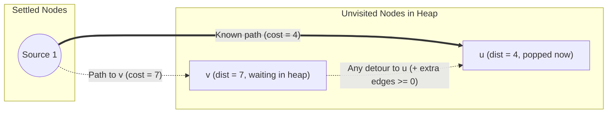

# Shortest Routes I

CSES 1671: https://cses.fi/problemset/task/1671

- Difficulty: Medium
- Topics: Graph, Shortest Path, Dijkstra's Algorithm, Priority Queue
- Discussed: [Week 13, Day 2](../../weekly_material/week13_day2.md)

## Summary

There are $n$ cities and $m$ flight connections. Your task is to determine the length of the shortest route from city 1 (Syrjälä) to every city $1, 2, \dots, n$.

## Intuition: Single-Source Shortest Path via Dijkstra's Algorithm

All edge weights are strictly positive ($c \ge 1$), making Dijkstra's algorithm with a min-heap the optimal approach:
1. Maintain an array `dist` initialized to $\infty$, with `dist[1] = 0`.
2. Push `(0, 1)` into a priority queue (min-heap ordered by distance).
3. In each step, pop `(curr_dist, city)`:
   - If `curr_dist > dist[city]`, this is a stale entry from an earlier distance assignment. Skip it (`continue`).
   - For each outgoing edge to `neighbor` with weight `flight_cost`:
     - If `dist[city] + flight_cost < dist[neighbor]`:
       - Update `dist[neighbor] = dist[city] + flight_cost`.
       - Push `(dist[neighbor], neighbor)` into the priority queue.
4. Output `dist[1], dist[2], ..., dist[num_cities]`.

## Correctness Intuition: Why Detours Cannot Beat Dijkstra

### 1. Observation from the Problem
- All edge weights are strictly positive ($c \ge 1 \ge 0$).
- Path costs are monotonically non-decreasing: extending any path can only add cost on top of what we already have, never decrease it.

### 2. The Detour Argument

- When the min-heap pops $u$ with tentative distance $dist[u] = 4$, could some unexplored detour through an unvisited vertex $v$ reach $u$ with a smaller total cost later?
- **No**:
  1. We consider the minimum first: $u$ was popped because its tentative distance is the smallest in the heap ($dist[u] \le dist[v]$, e.g. $4 \le 7$).
  2. Because all edges are non-negative, extending the path from $v$ to $u$ can only add more cost:
     $$\text{cost of detour} = dist[v] + \text{extra edges} \ge 7 + 0 \ge 4$$
  3. The detour is guaranteed to cost $\ge dist[u]$, and never a smaller cost.
- Therefore, $dist[u]$ is finalized and optimal the moment $u$ is popped.

## Hints

Hints

1. Edge weights are positive, which means Dijkstra's algorithm is applicable.
2. In C++, distances can sum to $> 2 \cdot 10^{14}$. Use 64-bit integers (`long long`) to avoid integer overflow.
3. Multiple edges can connect the same pair of cities. Dijkstra handles this naturally by relaxing the cheapest edge first.
4. Always skip stale heap entries: `if (d > dist[u]) continue;`.

## Solutions

- [Python Solution](solution.py)
- [C++ Solution](solution.cpp)

## Complexity Analysis

- **Time Complexity:** $O((V + E) \log V)$ where $V = n$ and $E = m$. Each vertex is extracted from the priority queue at most once as an active node. Each edge is relaxed once, pushing at most $E$ entries into the binary heap ($O(E \log V)$).
- **Space Complexity:** $O(V + E)$ to store the adjacency list representation, distance array, and priority queue.
