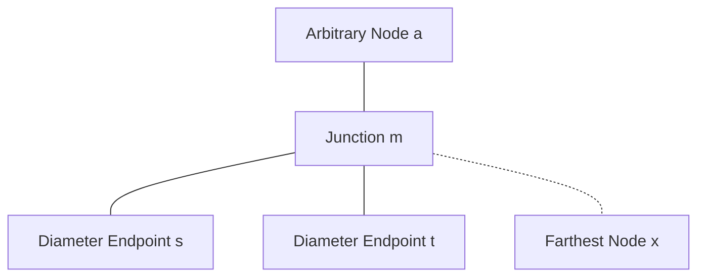
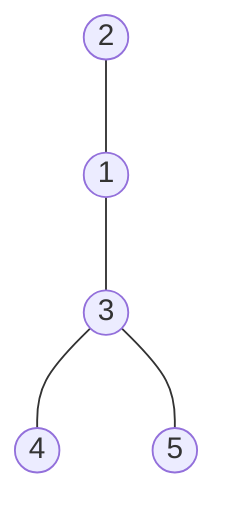
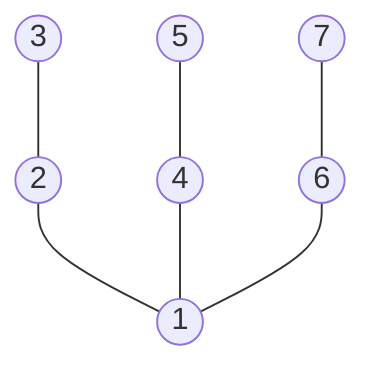

# Tree Diameter

CSES 1131: https://cses.fi/problemset/task/1131

- Difficulty: Medium
- Topics: Tree, Depth-First Search, Breadth-First Search, Graph Traversal
- Discussed: [Week 12, Day 1](../../weekly_material/week12_day1.md)

## Summary

You are given a tree consisting of $n$ nodes. The diameter of a tree is the maximum distance between two nodes (measured in number of edges). Count and return the diameter of the tree.

## The Two-Pass Traversal Algorithm

1. Pick any arbitrary node $a$ in the tree.
2. Run a traversal (DFS or BFS) starting at $a$ to find the farthest node from $a$. Let this node be $x$.
3. Run a second traversal (DFS or BFS) starting at $x$ to find the farthest node from $x$. Let this node be $y$.
4. The distance between $x$ and $y$, denoted $d(x, y)$, is the diameter of the tree.

## Tree Properties and the Junction Node

We base the correctness proof on the defining axioms of a tree:
1. **Connected:** A path exists between every pair of nodes.
2. **Acyclic (No cycles):** There are no simple cycles.

**Implication:** Between any two nodes $u$ and $v$, there is **exactly one unique simple path**, denoted $P(u, v)$.

Whenever we pick three nodes $a, b, c$ in a tree, their paths meet at a common junction node $m$.

<details>
<summary>Proof: Existence and Uniqueness of Junction Node m</summary>

**Claim:** For any three nodes $a, b, c$ in a tree, there exists a unique node $m$ where paths $P(a, b)$ and $P(a, c)$ diverge.

1. **Constructing the Junction:**
   - Both unique paths $P(a, b)$ and $P(a, c)$ start at node $a$.
   - Trace both paths simultaneously step by step from $a$. As long as they visit the exact same sequence of nodes, they share a common subpath.
   - Let $m$ be the last common node visited before the two paths branch to different neighbors.
2. **Uniqueness (Proof by Contradiction):**
   - After departing $m$, the path to $b$ and the path to $c$ take distinct edges.
   - If the path from $m$ to $b$ and the path from $m$ to $c$ met again at some later node $m'$, there would exist two distinct simple paths between $m$ and $m'$.
   - Combining these two distinct paths forms a cycle, directly contradicting the axiom that a tree is acyclic.
   - Therefore, the paths cannot meet again after $m$, making junction $m$ unique.

</details>



## Correctness Proof: The Distance Squeeze

### Claim
The node $x$ found by the first search from $a$ is an endpoint of a diameter path of length $D$.

### Definitions
1. Let $P(s, t)$ be an optimal diameter path of length $D = d(s, t) = d(m, s) + d(m, t)$.
2. Without loss of generality, assume $d(m, s) \ge d(m, t)$. (If not, swap the labels $s$ and $t$).
3. Let $x$ be the node at maximum distance from $a$, found by our search.

### The Squeeze on $x$
1. Because $x$ was chosen as the farthest node from $a$:
   $$d(a, x) \ge d(a, s) = d(a, m) + d(m, s)$$
2. By the path structure of the tree, the distance from $a$ to $x$ cannot exceed the distance through junction $m$:
   $$d(a, x) \le d(a, m) + d(m, x)$$
3. Combining (1) and (2):
   $$d(a, m) + d(m, x) \ge d(a, x) \ge d(a, m) + d(m, s)$$
   Subtracting $d(a, m)$ from both sides:
   $$d(m, x) \ge d(m, s)$$
4. Now examine the path between $t$ and $x$ through junction $m$:
   $$d(t, x) = d(t, m) + d(m, x) \ge d(t, m) + d(m, s) = D$$
5. Because $D$ is the diameter (the maximum distance between any pair of nodes in the tree), $d(t, x)$ cannot be strictly greater than $D$:
   $$d(t, x) \le D$$

### Conclusion
We have bounded $d(t, x)$ from both sides:
$$D \le d(t, x) \le D \implies d(t, x) = D$$
Therefore, $(t, x)$ is a valid diameter path of length $D$, and $x$ is an endpoint of a diameter.

Running the second search from $x$ will find a node $y$ at maximum distance from $x$, which must equal $D$.

> [!NOTE]
> Common Exam Pitfall: Do not claim that $x$ must equal $s$. $x$ can be a completely different node (for example, in a symmetric 3-arm star graph where three leaves are each at distance 5 from the center). The proof shows distance equality $d(t, x) = D$, not node identity $x = s$.

## Hints

<details>
<summary>Hints</summary>

1. A tree is connected and acyclic. Between any two nodes, there is exactly one simple path.
2. If you know one endpoint of the diameter, running BFS/DFS from it immediately finds the other endpoint and the diameter length.
3. How can you find one endpoint of the diameter in $O(n)$ time starting from nowhere?
4. Run BFS from node 1. The farthest node reached is guaranteed to be one endpoint of some diameter.

</details>

## Visual Examples and Test Cases

<details>
<summary>Examples, Diagrams, and Test Inputs</summary>

You can paste the edge list directly into the [CS Academy Graph Editor](https://csacademy.com/app/graph_editor/) (set graph type to undirected) to visualize the tree structure.

### Example 1: CSES Sample Tree



- **Input:**
  ```text
  5
  1 2
  1 3
  3 4
  3 5
  ```
- **Expected Output:**
  ```text
  3
  ```
- **Explanation:** The longest simple path connects leaf 2 to leaf 4 (path: 2 - 1 - 3 - 4) with 3 edges (or path 2 - 1 - 3 - 5).

---

### Example 2: Line Graph


- **Input:**
  ```text
  4
  1 2
  2 3
  3 4
  ```
- **Expected Output:**
  ```text
  3
  ```
- **Explanation:** In a line graph, the diameter is the path from the first leaf to the last leaf (path: 1 - 2 - 3 - 4) with 3 edges.

---

### Example 3: Symmetric Star Tree



- **Input:**
  ```text
  7
  1 2
  2 3
  1 4
  4 5
  1 6
  6 7
  ```
- **Expected Output:**
  ```text
  4
  ```
- **Explanation:** Any path between two outer leaves through center 1 (for example, 3 - 2 - 1 - 4 - 5) has length 2 + 2 = 4 edges.

</details>

## Solutions

- [Python Solution](solution.py)
- [C++ Solution](solution.cpp)

## Complexity Analysis

- **Time Complexity:** $O(V + E) = O(n)$. We run two standard BFS passes. In a tree with $n$ vertices, there are exactly $n - 1$ edges. Each pass visits every node and edge at most once.
- **Space Complexity:** $O(n)$ to store the adjacency list representation, distance array, and traversal queue.
