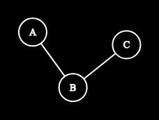
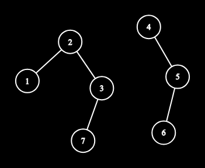
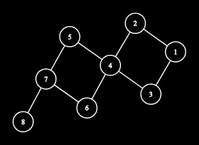
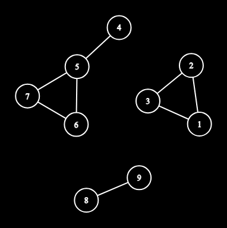
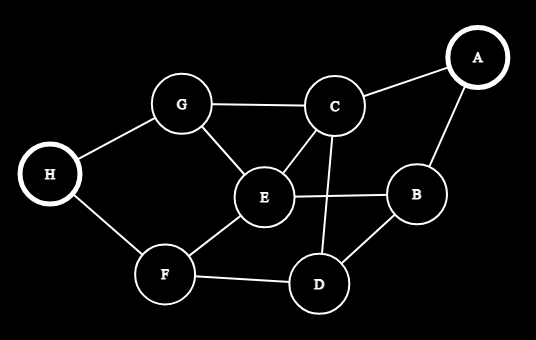
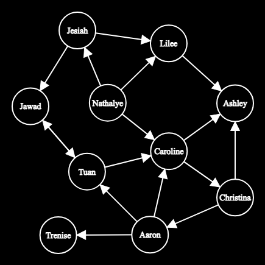
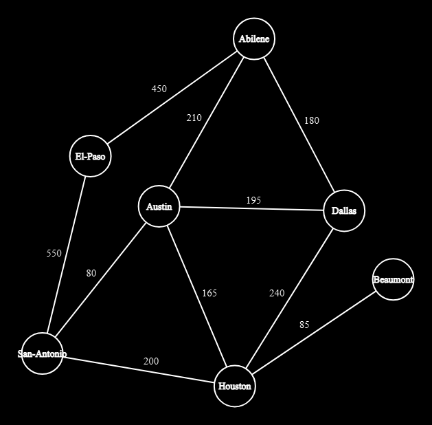

# Week 11, Day 1 (November 3, 2026)

## Today

Today we begin our unit on **Graph Theory**. We move beyond linear structures (arrays, linked lists) and hierarchical structures (trees) to general graphs, which model arbitrary networks and pairwise relationships.

Our in-class session covers through page 6 of the worksheet:
1. **Core Terminology:** Nodes (vertices), directed vs undirected edges, paths, cycles, connected components, and node degrees.
2. **In-Class Worksheet Scenarios 1 to 4:** Hands-on tracing of Fork in the Road, Disconnected Islands, Complex Mesh, and Social Media Following (directed reachability).
3. **Graph Representations in Code:** Translating graph structures into **Adjacency Lists** and **Adjacency Matrices** in Python and C++.
4. **Interactive Graph Visualizers:** Tools to construct and visualize custom graph structures.

> [!NOTE]
> We concluded this session after exploring Adjacency Lists and Matrices on page 6. Weighted graphs, Texas Cities, Minimum Spanning Trees (MST), Kruskal's algorithm, and Disjoint Set Union (DSU) from page 7 of the worksheet are grouped below under [5. Additional Material - To Be Covered in Later Sessions](#5-additional-material---to-be-covered-in-later-sessions).

---

## Session Resources

- **Presentation Slides:** [Graph Theory Walkthrough Presentation (Teams)](https://uofh.sharepoint.com/:p:/r/sites/Section_H_20263_IDNS_2197_24413/Shared%20Documents/General/Graph%20Theory%20Walkthrough%20-%20Copy.pptx?d=w2ea0689aa429498f984dc2a273a5c756&csf=1&web=1&e=n0LcPt)
- **In-Class Worksheet:** [Graph Theory Worksheet (PDF)](../misc_references/Graph%20Theory%20Worksheet.pdf)
- **Worksheet Diagrams:** [Extracted Diagrams Gallery (Dark Mode Inverted)](../misc_references/graph_worksheet_images/README.md)
- **Graph Editor (Edge List Visualizer):** [CS Academy Graph Editor](https://csacademy.com/app/graph_editor/) (enter edge pairs to draw and rearrange graphs instantly)
- **Algorithm Animations:** [VisuAlgo Graph Data Structures and Traversals](https://visualgo.net/en) (step-by-step interactive animations of BFS, DFS, Dijkstra, Kruskal, and Prim)
- **Online IDE:** [Online IDE Guide](../misc_references/online-ide.md) ([Judge0 IDE](https://ide.judge0.com/))

---

<details>
<summary>1. Core Graph Terminology</summary>

A graph $G = (V, E)$ consists of a set of **vertices** (or nodes) $V$ and a set of **edges** $E$.

1. **Node (Vertex):** The fundamental object representing an entity (such as a city, computer, web page, or user).
2. **Edge:** The connection between two vertices representing a relationship or route:
   - **Undirected Edge:** A two-way connection between $u$ and $v$ (written as $\{u, v\}$ or $u - v$). Traversal can go in either direction.
   - **Directed Edge (Arc):** A one-way connection from $u$ to $v$ (written as $(u, v)$ or $u \to v$). Traversal can only go from $u$ to $v$.
3. **Path:** A sequence of edges allowing travel from one vertex to another.
   - Example: $A \to B \to C$ connects $A$ to $C$.
   - A **simple path** visits no node more than once.

   

4. **Cycle:** A closed path that starts and ends at the exact same vertex, visiting no other vertex or edge more than once (e.g. $A \to B \to C \to A$). A graph with no cycles is called **acyclic**.
5. **Connected Component ("Island"):** A maximal sub-group of nodes where every node is reachable from every other node in that group. If a graph is disconnected, each isolated cluster forms its own component.

   

6. **Degree:**
   - In an undirected graph, the **degree** of a node is the number of edges attached to it.
   - In a directed graph:
     - **In-degree:** The number of incoming edges pointing into the node (e.g. number of followers).
     - **Out-degree:** The number of outgoing edges leaving the node (e.g. accounts followed). A node with out-degree 0 is a **sink**.

</details>

---

<details>
<summary>2. In-Class Worksheet Walkthrough (Scenarios 1 to 4)</summary>

Here is the step-by-step breakdown of the visual scenarios solved during class from pages 2 to 5 of the [Graph Theory Worksheet](../misc_references/Graph%20Theory%20Worksheet.pdf).

### Scenario 1: Fork In The Road



#### Questions and Solutions

1. **Is node 8 reachable from node 1?**
   - **Answer:** Yes.
   - **Reasoning:** A path exists from 1 to 8, for example: $1 \to 2 \to 4 \to 5 \to 7 \to 8$.

2. **What is the minimum number of edges to get from 1 to 7? Does that change if we add an edge connecting 2 and 5?**
   - **Answer:** 4 edges currently. Yes, adding edge $(2, 5)$ reduces the minimum to 3 edges.
   - **Reasoning:**
     - Current paths: $1 \to 2 \to 4 \to 5 \to 7$ or $1 \to 3 \to 4 \to 6 \to 7$ both use 4 edges.
     - With shortcut edge $(2, 5)$, we can take $1 \to 2 \to 5 \to 7$, which uses only 3 edges.

3. **How many ways can we reach 5 from 1? Assuming we cannot cross the same edge twice.**
   - **Answer:** 4 ways.
   - **Reasoning:**
     - Path 1: $1 \to 2 \to 4 \to 5$
     - Path 2: $1 \to 3 \to 4 \to 5$
     - Path 3: $1 \to 2 \to 4 \to 6 \to 7 \to 5$
     - Path 4: $1 \to 3 \to 4 \to 6 \to 7 \to 5$

4. **Does this graph contain any cycles? Write them down if they exist.**
   - **Answer:** Yes, it contains 2 simple cycles:
     - Cycle 1: $1 - 2 - 4 - 3 - 1$
     - Cycle 2: $4 - 5 - 7 - 6 - 4$

---

### Scenario 2: Disconnected Islands



#### Questions and Solutions

5. **Can you reach node 4 starting from node 1?**
   - **Answer:** No.
   - **Reasoning:** Nodes 1 and 4 belong to completely separate connected components. No sequence of edges connects them.

6. **How many "islands" (connected components) are in this graph?**
   - **Answer:** 3 connected components.
   - **Reasoning:**
     - Component 1: $\{1, 2, 3\}$
     - Component 2: $\{4, 5, 6, 7\}$
     - Component 3: $\{8, 9\}$

7. **What is the shortest path from 4 to 7?**
   - **Answer:** 2 edges ($4 \to 5 \to 7$).
   - **Reasoning:** Passing through node 5 directly reaches node 7 using 2 edges. An alternate path $4 \to 5 \to 6 \to 7$ uses 3 edges, which is longer.

8. **Does this graph contain any cycles?**
   - **Answer:** Yes, 2 cycles:
     - Triangle cycle in component 1: $1 - 2 - 3 - 1$
     - Triangle cycle in component 2: $5 - 7 - 6 - 5$

---

### Scenario 3: Complex Mesh



#### Questions and Solutions

9. **Trace two different paths from A to F. Which one is shorter?**
   - **Answer:**
     - Path 1: $A \to B \to E \to F$ (3 edges)
     - Path 2: $A \to C \to G \to H \to F$ (4 edges)
     - Path 1 (3 edges) is shorter. Other 3-edge paths include $A \to B \to D \to F$ and $A \to C \to E \to F$.

10. **How many "islands" (connected components) are in this graph?**
    - **Answer:** 1 connected component.
    - **Reasoning:** The graph is fully connected. Every vertex has at least one path to every other vertex.

11. **What is the shortest path from A to H?**
    - **Answer:** 3 edges ($A \to C \to G \to H$).
    - **Reasoning:** Moving through the top cluster takes 3 edges. Routes going through $B$ or $D$ take at least 4 edges (such as $A \to B \to E \to G \to H$).

12. **Identify at least three cycles in this graph.**
    - **Answer:**
      - Cycle 1: $C - E - G - C$ (triangle)
      - Cycle 2: $A - B - E - C - A$ (4 nodes)
      - Cycle 3: $G - H - F - E - G$ (4 nodes)
      - Additional valid cycles: $C - D - F - E - C$ or $A - B - D - C - A$.

13. **What is the max number of "neighbors" of a node across all nodes?**
    - **Answer:** 4 neighbors.
    - **Reasoning:**
      - Node A: degree 2 (B, C)
      - Node B: degree 3 (A, E, D)
      - Node C: degree 4 (A, G, E, D)
      - Node D: degree 3 (B, C, F)
      - Node E: degree 4 (B, C, G, F)
      - Node F: degree 3 (D, E, H)
      - Node G: degree 3 (C, E, H)
      - Node H: degree 2 (G, F)
      - Both node C and node E achieve the maximum degree of 4.

---

### Scenario 4: Social Media Following (Directed Graph)



#### Questions and Solutions

14. **Which node has the highest in-degree? (highest number of followers)**
    - **Answer:** Ashley and Caroline (tied with 3 followers each).
    - **Reasoning:**
      - Ashley receives 3 incoming arrows: from Lilee, Caroline, and Christina.
      - Caroline receives 3 incoming arrows: from Nathalye, Tuan, and Aaron.

15. **Which nodes have 0 out-degree? (not following anyone)**
    - **Answer:** Ashley and Trenise.
    - **Reasoning:** Neither Ashley nor Trenise has any outgoing arrows. In graph terms, they are sink vertices.

16. **If we only look at "Following" lists, can we go from Jesiah to Aaron? Can we go the opposite direction?**
    - **Answer:**
      - **Jesiah to Aaron:** Yes.
        Path: $\text{Jesiah} \to \text{Jawad} \to \text{Tuan} \to \text{Caroline} \to \text{Christina} \to \text{Aaron}$.
      - **Aaron to Jesiah:** No.
        From Aaron, reachable nodes are Trenise, Caroline, Ashley, Christina, Tuan, and Jawad. None of these nodes have an outgoing edge pointing back to Nathalye or Jesiah.

</details>

---

<details>
<summary>3. Graph Representations in Code</summary>

Page 6 of the worksheet explores how graphs are stored in computer memory. The two canonical representations are the **Adjacency List** and the **Adjacency Matrix**.

### 1. Adjacency List

An Adjacency List associates each vertex with a list of its directly connected neighbors. In Python, this is typically a dictionary of lists. In C++, it is a `vector<vector<int>>`.

#### Python

```python
# Adjacency list representation
adj_list = {
    1: [2, 3],
    2: [4],
    3: [4],
    4: [5, 6],
    5: [7],
    6: [7],
    7: [8],
    8: []
}

# Explore all neighbors of node 4
for neighbor in adj_list[4]:
    print(neighbor)
```

#### C++ (C++20 Standard)

```cpp
#include <iostream>
#include <vector>

int main() {
    int n = 8;
    std::vector<std::vector<int>> adj(n + 1);
    adj[1] = {2, 3};
    adj[2] = {4};
    adj[3] = {4};
    adj[4] = {5, 6};
    adj[5] = {7};
    adj[6] = {7};
    adj[7] = {8};

    // Explore all neighbors of node 4
    for (int neighbor : adj[4]) {
        std::cout << neighbor << "\n";
    }
    return 0;
}
```

---

### 2. Adjacency Matrix

An Adjacency Matrix is a 2D array of size $V \times V$, where `matrix[u][v] == 1` indicates an edge from $u$ to $v$, and `0` indicates no edge.

#### Python

```python
# Adjacency matrix (8x8, 0-indexed for nodes 1 to 8)
matrix = [
    [0, 1, 1, 0, 0, 0, 0, 0],  # Node 1
    [0, 0, 0, 1, 0, 0, 0, 0],  # Node 2
    [0, 0, 0, 1, 0, 0, 0, 0],  # Node 3
    [0, 0, 0, 0, 1, 1, 0, 0],  # Node 4
    [0, 0, 0, 0, 0, 0, 1, 0],  # Node 5
    [0, 0, 0, 0, 0, 0, 1, 0],  # Node 6
    [0, 0, 0, 0, 0, 0, 0, 1],  # Node 7
    [0, 0, 0, 0, 0, 0, 0, 0]   # Node 8
]

# Explore neighbors of node 4 (index 3)
node_four_index = 3
for index, connected in enumerate(matrix[node_four_index]):
    if connected == 1:
        print(index + 1)
```

#### C++ (C++20 Standard)

```cpp
#include <iostream>
#include <vector>

int main() {
    int n = 8;
    std::vector<std::vector<int>> matrix(n + 1, std::vector<int>(n + 1, 0));
    matrix[1][2] = 1; matrix[1][3] = 1;
    matrix[2][4] = 1;
    matrix[3][4] = 1;
    matrix[4][5] = 1; matrix[4][6] = 1;
    matrix[5][7] = 1;
    matrix[6][7] = 1;
    matrix[7][8] = 1;

    // Explore neighbors of node 4
    for (int neighbor = 1; neighbor <= n; ++neighbor) {
        if (matrix[4][neighbor] == 1) {
            std::cout << neighbor << "\n";
        }
    }
    return 0;
}
```

---

### Tradeoff Comparison

| Feature / Operation | Adjacency List | Adjacency Matrix |
| :--- | :--- | :--- |
| **Space Complexity** | $O(V + E)$ (optimal for sparse graphs) | $O(V^2)$ (wastes memory if few edges) |
| **Check if $(u, v)$ is an edge** | $O(\text{degree}(u))$ | $O(1)$ instant lookup |
| **Iterate over all neighbors of $u$** | $O(\text{degree}(u))$ | $O(V)$ scan through row $u$ |
| **Add a new edge** | $O(1)$ append | $O(1)$ assignment |
| **Best suited for** | Most competitive programming problems, sparse graphs | Dense graphs ($E \approx V^2$), constant-time edge queries |

</details>

---

<details>
<summary>4. Interactive Graph Visualizers</summary>

When solving graph problems, visualizing the structure can make hidden patterns and algorithm behaviors obvious:

1. **[CS Academy Graph Editor](https://csacademy.com/app/graph_editor/)**
   - **What it is:** A web tool for quickly drawing graphs given a list of edges.
   - **How to use it:**
     - Paste pairs of nodes in the text box (e.g. `1 2`, `1 3`, `2 4`).
     - Toggle between **Directed** and **Undirected** modes.
     - Drag nodes freely to inspect components and cycles.

2. **[VisuAlgo](https://visualgo.net/en)**
   - **What it is:** Visual animations for fundamental data structures and graph algorithms.
   - **Key modules to explore:**
     - **Graph Traversal:** Animated step-by-step Breadth-First Search (BFS) and Depth-First Search (DFS).
     - **Single-Source Shortest Paths:** Dijkstra's algorithm running on weighted graphs.
     - **Minimum Spanning Tree:** Kruskal's and Prim's algorithms showing edge-by-edge tree construction.

</details>

---

<details>
<summary>5. Additional Material - To Be Covered in Later Sessions</summary>

> [!NOTE]
> During our Week 11 Day 1 session, we stopped on page 6 of the worksheet. The material below covers page 7 (Texas Cities), edge weights, Minimum Spanning Trees (MST), Kruskal's algorithm, and Disjoint Set Union (DSU), which will be taught in upcoming workshops.

### Weighted Graphs

In a weighted graph, every edge $(u, v)$ has an associated numerical value (weight) $w$, representing cost, length, capacity, or latency.

- **Adjacency List with Weights:**
  Each neighbor entry becomes a tuple or pair `(neighbor, weight)`:
  ```python
  adj = {
      "Houston": [("Austin", 165), ("Beaumont", 85), ("San-Antonio", 200)],
      "Austin": [("Houston", 165), ("San-Antonio", 80), ("Dallas", 195)]
  }
  ```
- **Adjacency Matrix with Weights:**
  Instead of storing 1, `matrix[u][v]` stores the edge weight $w$. Missing edges are typically filled with $\infty$ (infinity) or 0 depending on the problem.

---

### Scenario 5: Texas Cities (Worksheet Page 7)



#### Questions and Solutions

17. **What is the shortest path (sum of distances across edges) from Houston to El-Paso?**
    - **Answer:** 750 miles.
    - **Path:** $\text{Houston} \to \text{San-Antonio} \to \text{El-Paso}$ ($200 + 550 = 750$).
    - **Comparison with other routes:**
      - Via Austin and San Antonio: $165 + 80 + 550 = 795$ miles.
      - Via Austin and Abilene: $165 + 210 + 450 = 825$ miles.
      - Via Dallas and Abilene: $240 + 180 + 450 = 870$ miles.

18. **If the direct 200-mile route from Houston to San-Antonio is closed, what would the answer become?**
    - **Answer:** 795 miles.
    - **Path:** Detour via Austin: $\text{Houston} \to \text{Austin} \to \text{San-Antonio} \to \text{El-Paso}$ ($165 + 80 + 550 = 795$).

19. **Stretch Problem: Connecting all cities with minimum total mileage and no redundant loops (Minimum Spanning Tree).**
    - **Answer:** 1,155 miles using 6 highway segments.
    - **Concept:** This is the **Minimum Spanning Tree (MST)** problem, solved greedily via Kruskal's algorithm (selecting lowest-weight edges that do not form a cycle).
    - **Step-by-step edge selection (7 cities, need $7 - 1 = 6$ edges):**
      1. Austin to San-Antonio: 80 (Pick)
      2. Houston to Beaumont: 85 (Pick)
      3. Houston to Austin: 165 (Pick)
      4. Abilene to Dallas: 180 (Pick)
      5. Austin to Dallas: 195 (Pick)
      6. Houston to San-Antonio (200): Skip (forms cycle Austin - San-Antonio - Houston)
      7. Austin to Abilene (210): Skip (forms cycle Austin - Dallas - Abilene)
      8. Houston to Dallas (240): Skip (forms cycle)
      9. Abilene to El-Paso: 450 (Pick, connects El-Paso)
      10. San-Antonio to El-Paso (550): Skip (forms cycle)
    - **Total mileage:** $80 + 85 + 165 + 180 + 195 + 450 = 1{,}155$ miles.

---

### Minimum Spanning Trees (MST) and Kruskal's Algorithm

A **Spanning Tree** of a connected, undirected graph with $V$ vertices is a subgraph that:
1. Includes all $V$ vertices.
2. Contains exactly $V - 1$ edges.
3. Has no cycles (it is a tree).

The **Minimum Spanning Tree (MST)** is the spanning tree that achieves the minimum possible total edge weight.

#### Kruskal's Algorithm (Greedy Approach)

1. Sort all edges in ascending order of their weights.
2. Iterate through sorted edges:
   - If adding the edge does not create a cycle, include it in the MST.
   - If adding the edge creates a cycle, discard it.
3. Stop when $V - 1$ edges have been selected.

---

### Disjoint Set Union (DSU / Union-Find) Preview

To check whether adding an edge creates a cycle in nearly $O(1)$ time, Kruskal's algorithm relies on a **Disjoint Set Union (DSU)** data structure with path compression and union by rank.

#### Python Preview

```python
class DSU:
    def __init__(self, n: int):
        self.parent = list(range(n))
        self.rank = [0] * n

    def find(self, x: int) -> int:
        if self.parent[x] != x:
            self.parent[x] = self.find(self.parent[x])
        return self.parent[x]

    def union(self, x: int, y: int) -> bool:
        root_x = self.find(x)
        root_y = self.find(y)
        if root_x == root_y:
            return False  # Same component, adding edge creates a cycle
        if self.rank[root_x] < self.rank[root_y]:
            root_x, root_y = root_y, root_x
        self.parent[root_y] = root_x
        if self.rank[root_x] == self.rank[root_y]:
            self.rank[root_x] += 1
        return True
```

#### C++ Preview (C++20 Standard)

```cpp
#include <vector>
#include <numeric>
#include <utility>

class DSU {
public:
    std::vector<int> parent;
    std::vector<int> rank;

    explicit DSU(int n) : parent(n), rank(n, 0) {
        std::iota(parent.begin(), parent.end(), 0);
    }

    int find(int x) {
        if (parent[x] != x) {
            parent[x] = find(parent[x]);
        }
        return parent[x];
    }

    bool unite(int x, int y) {
        int root_x = find(x);
        int root_y = find(y);
        if (root_x == root_y) {
            return false;
        }
        if (rank[root_x] < rank[root_y]) {
            std::swap(root_x, root_y);
        }
        parent[root_y] = root_x;
        if (rank[root_x] == rank[root_y]) {
            rank[root_x]++;
        }
        return true;
    }
};
```

</details>
