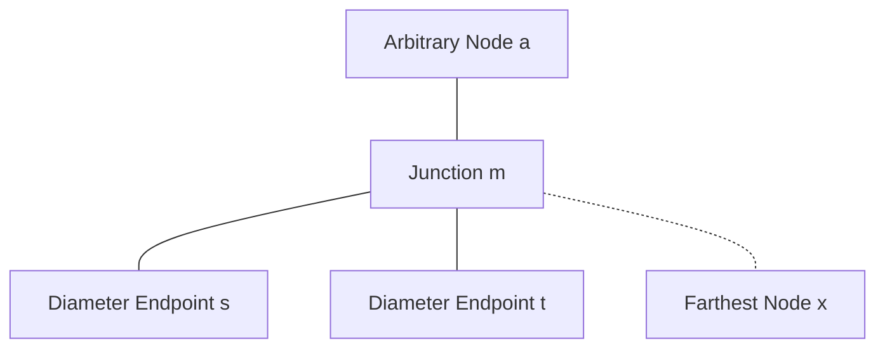
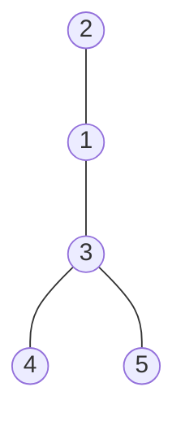
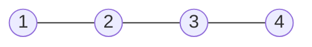
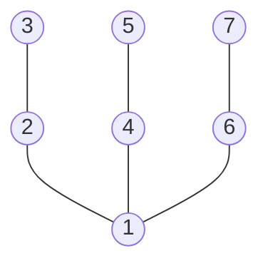
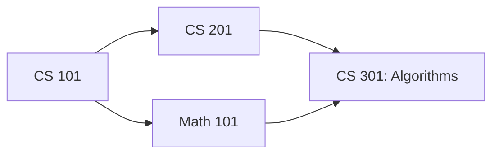
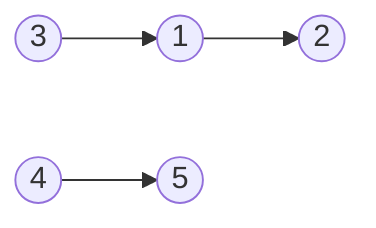
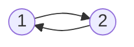
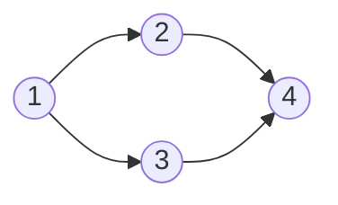

# Week 12, Day 1 (November 10, 2026)

## Today

Today we explore two foundational graph patterns: tree structures and dependency resolution on directed graphs:
1. **Tree Diameter via Double Traversal:** Finding the longest simple path in a tree using two BFS/DFS passes.
2. **Tree Properties and Squeeze Proof:** Starting from foundational tree axioms (acyclic, connected, unique paths), proving the existence of a unique junction node $m$ for any three nodes, and using the distance squeeze to prove that the two-pass algorithm finds an optimal diameter ($d(t, x) = D$).
3. **Problem 1: Tree Diameter** ([CSES 1131](https://cses.fi/problemset/task/1131)).
4. **Directed Acyclic Graphs (DAGs) and Topological Sort:** Ordering tasks that have prerequisites.
5. **Kahn's Algorithm and the Exchange Argument:** Proving why greedily choosing any in-degree 0 vertex preserves validity, inductive termination, and cycle detection.
6. **Problem 2: Course Schedule** ([CSES 1679](https://cses.fi/problemset/task/1679) / [LeetCode 210](https://leetcode.com/problems/course-schedule-ii/description/)).

You can write and test your code without local setup using the [Online IDE Guide](../misc_references/online-ide.md) ([Judge0 IDE](https://ide.judge0.com/)).

---

## Session Resources

- **Tree Diameter:** [CSES 1131](https://cses.fi/problemset/task/1131)
- **Course Schedule:** [CSES 1679](https://cses.fi/problemset/task/1679)
- **Course Schedule II:** [LeetCode 210](https://leetcode.com/problems/course-schedule-ii/description/)
- **Graph Visualizer:** [CS Academy Graph Editor](https://csacademy.com/app/graph_editor/)
- **Algorithm Animations:** [VisuAlgo Graph Traversal](https://visualgo.net/en/dfsbfs)
- **Online IDE:** [Online IDE Guide](../misc_references/online-ide.md) ([Judge0 IDE](https://ide.judge0.com/))

---

<details>
<summary>1. Tree Diameter: The Two-Pass Traversal Algorithm</summary>

### What is the Diameter of a Tree?

The **diameter** of an unweighted tree is the length (measured in number of edges) of the longest simple path between any pair of vertices in the tree.

Because a tree has no cycles and is connected:
- There is exactly one simple path between any two vertices.
- The diameter path connects two leaves (or a single vertex if $n = 1$).

### The Two-Pass Algorithm

Instead of checking all pairs of nodes (which takes $O(n^2)$ time), we can find the diameter in $O(n)$ time using two simple traversals:

```text
Algorithm TreeDiameter(tree):
    1. Pick an arbitrary node a (for example, node 1).
    2. Run BFS (or DFS) starting from a to find the farthest node x from a.
    3. Run a second BFS (or DFS) starting from x to find the farthest node y from x.
    4. Return d(x, y), which is the exact diameter D.
```

### Starter Code

```python
from collections import deque


def find_diameter(n: int, edges: list[tuple[int, int]]) -> int:
    # Build adjacency list
    adj = [[] for _ in range(n + 1)]
    for u, v in edges:
        adj[u].append(v)
        adj[v].append(u)

    # Step 1: Run traversal from node 1 to find farthest node x
    # Step 2: Run traversal from node x to find farthest node y and distance d(x, y)
    pass
```

</details>

---

<details>
<summary>2. Tree Properties and Correctness Proof</summary>

### The Starting Axioms of a Tree

We base our proof on two defining axioms of any tree:
1. **Connected:** There is a path between every pair of nodes.
2. **Acyclic (No Cycles):** There is no path that starts and ends at the same node without traversing some edge twice.

**Immediate Implication:**
Because a tree is connected and acyclic, between any two nodes $u$ and $v$, there is **exactly one unique simple path**, denoted $P(u, v)$. If there were two distinct simple paths, their union would form a cycle, violating Axiom 2.

---

### The Three-Path Junction Property

Whenever you choose any three nodes $a, b, c$ in a tree, their paths meet at a common junction node $m$.

<details>
<summary>Proof: Existence and Uniqueness of Junction Node m</summary>

**Claim:** For any three nodes $a, b, c$ in a tree, there exists a unique node $m$ where the paths $P(a, b)$ and $P(a, c)$ diverge.

1. **Constructing the Junction:**
   - Both unique paths $P(a, b)$ and $P(a, c)$ start at node $a$.
   - Trace both paths simultaneously step by step starting from $a$. As long as they visit the exact same sequence of nodes, they share a common subpath.
   - Let $m$ be the last common node visited before the two paths branch to different neighbors. (If one path is entirely contained in the other, say $b$ lies on $P(a, c)$, then $m = b$).
2. **Uniqueness (Proof by Contradiction):**
   - After departing $m$, the path toward $b$ and the path toward $c$ take distinct edges.
   - Suppose the path from $m$ to $b$ and the path from $m$ to $c$ meet again at some later node $m'$.
   - Then there would exist two distinct simple paths between $m$ and $m'$: one along $P(a, b)$ and one along $P(a, c)$.
   - Combining these two distinct paths forms a cycle, directly contradicting the axiom that a tree is acyclic.
   - Therefore, the paths can never meet again after $m$. The junction node $m$ is unique.

</details>



---

### Decomposing Distances Around a Diameter

Let $s$ and $t$ be endpoints of an optimal diameter path $P(s, t)$ of length $D = d(s, t)$.
Let $a$ be an arbitrary starting node. By the junction property for nodes $a, s, t$, their unique paths meet at junction node $m$:
- $D = d(s, t) = d(m, s) + d(m, t)$
- $d(a, s) = d(a, m) + d(m, s)$
- $d(a, t) = d(a, m) + d(m, t)$

Without loss of generality, assume $d(m, s) \ge d(m, t)$ (if not, swap the labels $s$ and $t$).

---

### The Squeeze Proof for Tree Diameter

Suppose our first traversal starts at $a$ and finds a node $x$ that maximizes distance from $a$.

#### 1. The Lower Bound on d(m, x)
Because $x$ was chosen as the farthest node from $a$:
$$d(a, x) \ge d(a, s) = d(a, m) + d(m, s)$$

The path from $a$ to $x$ either passes through $m$ or branches off earlier. By the path structure of trees:
$$d(a, x) \le d(a, m) + d(m, x)$$

Combining these two inequalities:
$$d(a, m) + d(m, x) \ge d(a, x) \ge d(a, m) + d(m, s)$$

Subtract $d(a, m)$ from both sides:
$$d(m, x) \ge d(m, s)$$

#### 2. The Path from t to x
Now evaluate the path between $t$ and $x$ through junction $m$:
$$d(t, x) = d(t, m) + d(m, x)$$

Substitute our lower bound $d(m, x) \ge d(m, s)$:
$$d(t, x) \ge d(t, m) + d(m, s) = D$$

#### 3. Squeezing Against the Diameter
By definition, $D$ is the maximum distance between any two nodes in the entire tree. Therefore, no path can have length strictly greater than $D$:
$$d(t, x) \le D$$

We have squeezed $d(t, x)$ from above and below:
$$D \le d(t, x) \le D \implies d(t, x) = D$$

#### Conclusion
The path between $t$ and $x$ has length exactly $D$. This proves:
1. $(t, x)$ is a valid diameter path.
2. Node $x$ found by the first search is guaranteed to be an endpoint of an optimal diameter path.
3. Running a second search from $x$ will find a node at distance $D$, correctly returning the diameter.

> [!WARNING]
> Common Proof Mistake: Do not write "therefore $x = s$".
> $x$ does not need to be the same node as $s$. For example, in a 3-arm star tree where leaves $s$, $t$, and $x$ are each at distance 5 from center $m$, both $(s, t)$ and $(x, t)$ are valid diameter paths of length 10. The proof establishes **distance equality** ($d(t, x) = D$), not node identity.

</details>

---

<details>
<summary>3. Problem 1: Tree Diameter (CSES 1131)</summary>

### Problem Statement

You are given a tree consisting of $n$ nodes. The diameter of a tree is the maximum distance between two nodes. Your task is to count the diameter of the tree.

- Input: First line has integer $n$ ($1 \le n \le 2 \cdot 10^5$). Then $n - 1$ lines describe the edges $a$ and $b$.
- Output: Print one integer: the diameter of the tree.

[CSES 1131: Tree Diameter](https://cses.fi/problemset/task/1131)

### Hints

<details>
<summary>Hints</summary>

1. A tree with $n$ nodes has exactly $n - 1$ edges and no cycles.
2. In Python, a deep tree (such as a line of $2 \cdot 10^5$ nodes) can exceed the recursion limit. Breadth-First Search (BFS) with a queue avoids recursion limits completely.
3. Write a helper function `find_farthest(start_node)` that runs BFS and returns a pair: `(farthest_node, max_distance)`.
4. Call `find_farthest(1)` to obtain `(first_end, _)`.
5. Call `find_farthest(first_end)` to obtain `(second_end, diameter)`.

</details>

### Solution Idea

<details>
<summary>Solution Idea</summary>

1. Build an adjacency list for 1-indexed nodes from $1$ to $n$.
2. Define a BFS function that takes `start_node`. It initializes a `dist` array with `-1`, sets `dist[start_node] = 0`, and pushes `start_node` into a queue.
3. While the queue is not empty, pop $u$, check if $dist[u] > dist[farthest]$, and update $farthest = u$. For each unvisited neighbor $v$, set $dist[v] = dist[u] + 1$ and push $v$.
4. Return `(farthest, dist[farthest])`.
5. Run BFS once from node 1 to find `first_end`.
6. Run BFS once from `first_end` to find the diameter.
7. Print the diameter.

</details>

### Visual Examples and Test Cases

<details>
<summary>Examples, Diagrams, and Test Inputs</summary>

You can paste the edge list directly into the [CS Academy Graph Editor](https://csacademy.com/app/graph_editor/) (set graph type to undirected) to visualize the tree structure.

#### Example 1: CSES Sample Tree



- **Input:**
  ```text
  5
  1 2
  1 3
  3 4
  3 5
  ```
- **Expected Output:**
  ```text
  3
  ```
- **Explanation:** The longest simple path connects leaf 2 to leaf 4 (path: 2 - 1 - 3 - 4) with 3 edges (or path 2 - 1 - 3 - 5).

---

#### Example 2: Line Graph



- **Input:**
  ```text
  4
  1 2
  2 3
  3 4
  ```
- **Expected Output:**
  ```text
  3
  ```
- **Explanation:** In a line graph, the diameter is the path from the first leaf to the last leaf (path: 1 - 2 - 3 - 4) with 3 edges.

---

#### Example 3: Symmetric Star Tree



- **Input:**
  ```text
  7
  1 2
  2 3
  1 4
  4 5
  1 6
  6 7
  ```
- **Expected Output:**
  ```text
  4
  ```
- **Explanation:** Any path between two outer leaves through center 1 (for example, 3 - 2 - 1 - 4 - 5) has length 2 + 2 = 4 edges.

</details>

### Code Links

- [Problem Explanation and Complexity Analysis](../problem_solutions/tree-diameter/README.md)
- [Python Solution](../problem_solutions/tree-diameter/solution.py)
- [C++ Solution](../problem_solutions/tree-diameter/solution.cpp)

</details>

---

<details>
<summary>4. Directed Acyclic Graphs (DAGs) and Topological Sort</summary>

### What is a Topological Sort?

Given a directed graph $G = (V, E)$, a **topological sort** is a linear ordering of vertices such that for every directed edge $u \to v$, vertex $u$ comes before vertex $v$ in the ordering.

Think of vertices as college courses and edges $u \to v$ as prerequisites ("you must take course $u$ before course $v$"). A topological sort is any valid sequence of taking all courses one by one without violating prerequisites.



Valid orders:
- `[CS 101, Math 101, CS 201, CS 301]`
- `[CS 101, CS 201, Math 101, CS 301]`

### The Core Theorem: DAG Equivalence

A directed graph has a topological sort **if and only if** it contains no directed cycles. Such a graph is called a **Directed Acyclic Graph (DAG)**.

If a graph contains a cycle (e.g. $A \to B \to C \to A$), then $A$ must come before $B$, $B$ before $C$, and $C$ before $A$, which is impossible in any linear sequence.

---

### Kahn's Algorithm (BFS via In-Degrees)

Kahn's algorithm greedily peels away nodes that are ready to be scheduled:

1. **Compute In-Degrees:** For each node $v$, count how many incoming edges enter $v$.
2. **Collect Sources:** Any node with `in_degree == 0` has no remaining prerequisites. Push all such nodes into a queue.
3. **Peel Vertices:** While the queue is not empty:
   - Pop a node $u$ from the queue and append it to our topological order.
   - For each neighbor $v$ of $u$ (edges $u \to v$):
     - Decrement `in_degree[v]` by 1.
     - If `in_degree[v] == 0`, all prerequisites for $v$ have been satisfied. Push $v$ into the queue.
4. **Detect Cycles:** If the output order contains all $V$ nodes, return the order. If fewer than $V$ nodes were processed, a cycle prevented the remaining nodes from ever reaching `in_degree == 0`.

</details>

---

<details>
<summary>5. Kahn's Algorithm Proof: The Exchange Argument and Cycle Detection</summary>

### Where Does the Exchange Argument Plug In?

Kahn's algorithm is fundamentally a **greedy algorithm**: whenever several vertices have `in_degree == 0`, it arbitrarily chooses any of them to place next.

A classic exam question is:
> *"Does making this greedy choice right now risk getting us stuck later? Could choosing vertex $u$ first make it impossible to finish a valid topological sort, even if one existed?"*

We prove that Kahn's greedy choice is safe using an **exchange argument**.

---

### 1. Existence: Every Finite DAG Has an In-Degree 0 Vertex

- **Claim:** Every finite DAG has at least one vertex with in-degree 0.
- **Proof:** Suppose for contradiction that every vertex in a DAG of $n$ vertices has in-degree $\ge 1$.
  - Start at any vertex $v_1$. Because its in-degree is at least 1, choose an incoming edge $(v_2, v_1)$.
  - Move to $v_2$. It also has an incoming edge $(v_3, v_2)$.
  - Continue walking backward along incoming edges: $v_1 \leftarrow v_2 \leftarrow v_3 \leftarrow \dots$
  - Because the graph has only $n$ vertices, by the Pigeonhole Principle, we must revisit a previously visited vertex within $n$ steps.
  - Reversing that cycle of backward steps reveals a forward directed cycle:
    $$v_k \to v_{k-1} \to \dots \to v_j \to v_k$$
  - This contradicts the assumption that the graph is acyclic.
  - Therefore, at least one vertex must have in-degree 0.

---

### 2. The Exchange Argument: Greedily Picking In-Degree 0 Is Always Safe

- **Claim:** If a graph $G$ has a valid topological sort, and vertex $u$ has in-degree 0 in $G$, then there exists a valid topological sort of $G$ that starts with $u$.
- **Proof via Exchange Argument:**
  - Let $O = [v_1, v_2, \dots, v_k, \dots, v_n]$ be any valid topological sort of $G$.
  - If $v_1 = u$, then $O$ already starts with $u$, and we are done.
  - Suppose $u$ appears later at index $k > 1$:
    $$O = [v_1, v_2, \dots, v_{k-1}, u, v_{k+1}, \dots, v_n]$$
  - Construct an exchanged order $O'$ by moving $u$ to the very front:
    $$O' = [u, v_1, v_2, \dots, v_{k-1}, v_{k+1}, \dots, v_n]$$
  - Let us check if $O'$ violates any directed edge:
    1. **Edges between other vertices:** The relative order among all vertices other than $u$ has not changed. Any edge between $v_i$ and $v_j$ remains satisfied.
    2. **Incoming edges to $u$:** An edge could only be violated if it points into $u$ from some vertex that was placed before $u$ in $O$ (i.e. an edge $v_i \to u$ for $i < k$). But $u$ has **in-degree 0 in $G$**, which means **there are no edges pointing into $u$ at all**.
    3. **Outgoing edges from $u$:** Since $u$ is now at the very front of $O'$, all its outgoing edges point forward to vertices that appear after $u$.
  - Therefore, $O'$ is a completely valid topological sort that begins with $u$.
  - This proves that greedily choosing any in-degree 0 vertex never destroys our ability to reach a valid topological ordering.

---

### 3. Inductive Step: Graph Shrinkage and DAG Invariant

We formalize the inductive argument on the number of vertices $n$:

- **Base Case ($n = 1$):** A single vertex with no self-loops trivially has in-degree 0. It is placed into the order, satisfying all dependencies.
- **Inductive Hypothesis:** Assume Kahn's algorithm correctly outputs a valid topological sort for any DAG containing fewer than $n$ vertices.
- **Inductive Step (for $n$ vertices):**
  1. By Step 1, graph $G$ has at least one vertex $u$ with `in_degree == 0`.
  2. By the Exchange Argument (Step 2), placing $u$ first is guaranteed to be safe and extendable to a valid topological sort.
  3. When Kahn's algorithm processes $u$, it removes $u$ and all its outgoing edges $u \to v$ from the graph:
     - For each neighbor $v$, removing the directed edge $u \to v$ decrements `in_degree[v]` by 1.
     - This simulates that prerequisite $u$ has been completed, potentially freeing up new vertices whose in-degrees now reach 0.
  4. Let the resulting remaining subgraph be $G' = G - \{u\}$.
  5. **Why must $G'$ remain a valid DAG?**
     - Deleting vertices and edges can never create new cycles. If $G'$ contained a cycle, that exact same cycle must have already existed in $G$, which contradicts our premise that $G$ is acyclic.
     - Therefore, $G'$ is guaranteed to remain a valid DAG on $n - 1$ vertices.
  6. By the inductive hypothesis, Kahn's algorithm correctly produces a valid topological sort for $G'$, say $[v_2, v_3, \dots, v_n]$.
  7. Prepending $u$ produces $[u, v_2, v_3, \dots, v_n]$, which is a valid topological sort for the entire $n$-vertex graph $G$.

---

### 4. Cycle Detection

If the queue runs empty while the number of scheduled vertices is strictly less than $n$:
- Every remaining unscheduled vertex must have `in_degree > 0`.
- By Step 1, any finite graph where every vertex has in-degree $\ge 1$ contains a cycle.
- Therefore, the remaining vertices form one or more cycles, and no valid topological sort can exist.

</details>

---

<details>
<summary>6. Problem 2: Course Schedule (CSES 1679 / LeetCode 210)</summary>

### Problem Statements

#### CSES 1679: Course Schedule
You are given $n$ courses and $m$ requirements of the form "course $a$ has to be completed before course $b$". Find an order in which you can take the courses so that all requirements are satisfied. If there are multiple solutions, print any of them. If it is impossible, print `IMPOSSIBLE`.
- Input: $1 \le n \le 10^5$, $1 \le m \le 2 \cdot 10^5$. Edges $a \to b$ are 1-indexed.
- [CSES 1679: Course Schedule](https://cses.fi/problemset/task/1679)

#### LeetCode 210: Course Schedule II
There are a total of `numCourses` courses you have to take, labeled from $0$ to `numCourses - 1`. You are given an array `prerequisites` where `prerequisites[i] = [a, b]` indicates you must take course $b$ first if you want to take course $a$ ($b \to a$). Return any valid ordering, or `[]` if impossible.
- [LeetCode 210: Course Schedule II](https://leetcode.com/problems/course-schedule-ii/description/)

### Starter Code (CSES 1679)

```python
from collections import deque
import sys


def main():
    input_data = sys.stdin.read().split()
    if not input_data:
        return

    n = int(input_data[0])
    m = int(input_data[1])

    # Step 1: Build adjacency list and compute in-degrees (1-indexed)

    # Step 2: Push all nodes with in_degree == 0 into a queue

    # Step 3: Process queue, append to top_sorted, decrement neighbor in-degrees

    # Step 4: If len(top_sorted) < n, print IMPOSSIBLE; otherwise print the order
    pass


if __name__ == "__main__":
    main()
```

### Hints

<details>
<summary>Hints</summary>

1. Be careful with edge directions! In LeetCode 210, `[a, b]` means $b$ must be taken before $a$, so the edge is $b \to a$. In CSES 1679, $a$ must be taken before $b$, so the edge is $a \to b$.
2. Maintain an array `in_degree` of size $n$, initialized to 0.
3. Every time you add directed edge $u \to v$, increment `in_degree[v] += 1`.
4. Initialize your queue with all vertices whose `in_degree == 0`.
5. When popping $u$, loop through each neighbor $v$ in `adj[u]`, decrement `in_degree[v] -= 1`, and if it reaches 0, push $v$ into the queue.
6. If the length of the result equals $n$, return it. Otherwise, return `[]` (or print `IMPOSSIBLE`).

</details>

### Solution Idea

<details>
<summary>Solution Idea</summary>

1. Build an adjacency list `adj` and an `in_degree` array.
2. Push all nodes with `in_degree[i] == 0` into a `collections.deque`.
3. Initialize an empty list `order`.
4. While the queue has elements:
   - Pop `u = q.popleft()`.
   - Append `u` to `order`.
   - For each neighbor `v` in `adj[u]`:
     - `in_degree[v] -= 1`
     - If `in_degree[v] == 0`:
       - `q.append(v)`
5. If `len(order) == numCourses`, return `order`. Otherwise, return `[]`.

</details>

### Visual Examples and Test Cases

<details>
<summary>Examples, Diagrams, and Test Inputs</summary>

You can paste the edge list directly into the [CS Academy Graph Editor](https://csacademy.com/app/graph_editor/) (set graph type to directed) to visualize course dependencies.

#### Example 1: Valid DAG with Multiple Branches (CSES Sample)



- **Input:**
  ```text
  5 3
  1 2
  3 1
  4 5
  ```
- **Expected Output:**
  ```text
  3 4 1 5 2
  ```
- **Explanation:** Courses 3 and 4 have in-degree 0; taking 3 unlocks 1, taking 1 unlocks 2, and taking 4 unlocks 5 (any valid topological order such as `4 3 1 5 2` is also accepted).

---

#### Example 2: Directed Cycle (Impossible)



- **Input:**
  ```text
  2 2
  1 2
  2 1
  ```
- **Expected Output:**
  ```text
  IMPOSSIBLE
  ```
- **Explanation:** Courses 1 and 2 depend on each other in a cycle, so neither course can ever reach in-degree 0.

---

#### Example 3: Diamond DAG



- **Input:**
  ```text
  4 4
  1 2
  1 3
  2 4
  3 4
  ```
- **Expected Output:**
  ```text
  1 2 3 4
  ```
- **Explanation:** Course 1 must be taken first, courses 2 and 3 can follow in either order, and course 4 must be taken last once both 2 and 3 are finished.

</details>

### Code Links

- [Problem Explanation and Complexity Analysis](../problem_solutions/course-schedule/README.md)
- [Python Solution](../problem_solutions/course-schedule/solution.py)
- [C++ Solution](../problem_solutions/course-schedule/solution.cpp)

</details>
