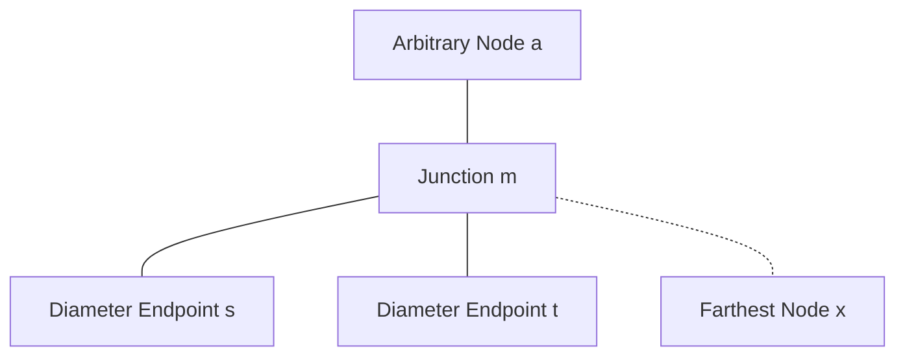
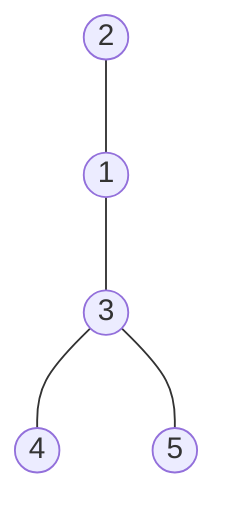
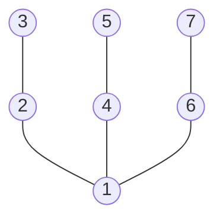

# Week 12, Day 1 (November 10, 2026)

## Today

Today we explore tree structures and the tree diameter problem:
1. **Tree Diameter via Double Traversal:** Finding the longest simple path in a tree using two BFS/DFS passes.
2. **Tree Properties and Squeeze Proof:** Starting from foundational tree axioms (acyclic, connected, unique paths), proving the existence of a unique junction node $m$ for any three nodes, and using the distance squeeze to prove that the two-pass algorithm finds an optimal diameter ($d(t, x) = D$).
3. **Problem: Tree Diameter** ([CSES 1131](https://cses.fi/problemset/task/1131)).

> [!NOTE]
> **Rollover Notice:** Topological Sort, Kahn's algorithm, and Course Schedule were moved to [Week 12, Day 2](./week12_day2.md) to allow for a thorough treatment of the tree diameter proof and double traversal implementations.

You can write and test your code without local setup using the [Online IDE Guide](../misc_references/online-ide.md) ([Judge0 IDE](https://ide.judge0.com/)).

---

## Session Resources

- **Tree Diameter:** [CSES 1131](https://cses.fi/problemset/task/1131)
- **Topological Sort (Moved to Day 2):** [Week 12, Day 2](./week12_day2.md)
- **Graph Visualizer:** [CS Academy Graph Editor](https://csacademy.com/app/graph_editor/)
- **Algorithm Animations:** [VisuAlgo Graph Traversal](https://visualgo.net/en/dfsbfs)
- **Online IDE:** [Online IDE Guide](../misc_references/online-ide.md) ([Judge0 IDE](https://ide.judge0.com/))

---

<details>
<summary>1. Tree Diameter: The Two-Pass Traversal Algorithm</summary>

### What is the Diameter of a Tree?

The **diameter** of an unweighted tree is the length (measured in number of edges) of the longest simple path between any pair of vertices in the tree.

Because a tree has no cycles and is connected:
- There is exactly one simple path between any two vertices.
- The diameter path connects two leaves (or a single vertex if $n = 1$).

### The Two-Pass Algorithm

Instead of checking all pairs of nodes (which takes $O(n^2)$ time), we can find the diameter in $O(n)$ time using two simple traversals:

```text
Algorithm TreeDiameter(tree):
    1. Pick an arbitrary node a (for example, node 1).
    2. Run BFS (or DFS) starting from a to find the farthest node x from a.
    3. Run a second BFS (or DFS) starting from x to find the farthest node y from x.
    4. Return d(x, y), which is the exact diameter D.
```

### Starter Code

```python
from collections import deque


def find_diameter(n: int, edges: list[tuple[int, int]]) -> int:
    # Build adjacency list
    adj = [[] for _ in range(n + 1)]
    for u, v in edges:
        adj[u].append(v)
        adj[v].append(u)

    # Step 1: Run traversal from node 1 to find farthest node x
    # Step 2: Run traversal from node x to find farthest node y and distance d(x, y)
    pass
```

</details>

---

<details>
<summary>2. Tree Properties and Correctness Proof</summary>

### The Starting Axioms of a Tree

We base our proof on two defining axioms of any tree:
1. **Connected:** There is a path between every pair of nodes.
2. **Acyclic (No Cycles):** There is no path that starts and ends at the same node without traversing some edge twice.

**Immediate Implication:**
Because a tree is connected and acyclic, between any two nodes $u$ and $v$, there is **exactly one unique simple path**, denoted $P(u, v)$. If there were two distinct simple paths, their union would form a cycle, violating Axiom 2.

---

### The Three-Path Junction Property

Whenever you choose any three nodes $a, b, c$ in a tree, their paths meet at a common junction node $m$.

<details>
<summary>Proof: Existence and Uniqueness of Junction Node m</summary>

**Claim:** For any three nodes $a, b, c$ in a tree, there exists a unique node $m$ where the paths $P(a, b)$ and $P(a, c)$ diverge.

1. **Constructing the Junction:**
   - Both unique paths $P(a, b)$ and $P(a, c)$ start at node $a$.
   - Trace both paths simultaneously step by step starting from $a$. As long as they visit the exact same sequence of nodes, they share a common subpath.
   - Let $m$ be the last common node visited before the two paths branch to different neighbors. (If one path is entirely contained in the other, say $b$ lies on $P(a, c)$, then $m = b$).
2. **Uniqueness (Proof by Contradiction):**
   - After departing $m$, the path toward $b$ and the path toward $c$ take distinct edges.
   - Suppose the path from $m$ to $b$ and the path from $m$ to $c$ meet again at some later node $m'$.
   - Then there would exist two distinct simple paths between $m$ and $m'$: one along $P(a, b)$ and one along $P(a, c)$.
   - Combining these two distinct paths forms a cycle, directly contradicting the axiom that a tree is acyclic.
   - Therefore, the paths can never meet again after $m$. The junction node $m$ is unique.

</details>



---

### Decomposing Distances Around a Diameter

Let $s$ and $t$ be endpoints of an optimal diameter path $P(s, t)$ of length $D = d(s, t)$.
Let $a$ be an arbitrary starting node. By the junction property for nodes $a, s, t$, their unique paths meet at junction node $m$:
- $D = d(s, t) = d(m, s) + d(m, t)$
- $d(a, s) = d(a, m) + d(m, s)$
- $d(a, t) = d(a, m) + d(m, t)$

Without loss of generality, assume $d(m, s) \ge d(m, t)$ (if not, swap the labels $s$ and $t$).

---

### The Squeeze Proof for Tree Diameter

Suppose our first traversal starts at $a$ and finds a node $x$ that maximizes distance from $a$.

#### 1. The Lower Bound on d(m, x)
Because $x$ was chosen as the farthest node from $a$:
$$d(a, x) \ge d(a, s) = d(a, m) + d(m, s)$$

The path from $a$ to $x$ either passes through $m$ or branches off earlier. By the path structure of trees:
$$d(a, x) \le d(a, m) + d(m, x)$$

Combining these two inequalities:
$$d(a, m) + d(m, x) \ge d(a, x) \ge d(a, m) + d(m, s)$$

Subtract $d(a, m)$ from both sides:
$$d(m, x) \ge d(m, s)$$

#### 2. The Path from t to x
Now evaluate the path between $t$ and $x$ through junction $m$:
$$d(t, x) = d(t, m) + d(m, x)$$

Substitute our lower bound $d(m, x) \ge d(m, s)$:
$$d(t, x) \ge d(t, m) + d(m, s) = D$$

#### 3. Squeezing Against the Diameter
By definition, $D$ is the maximum distance between any two nodes in the entire tree. Therefore, no path can have length strictly greater than $D$:
$$d(t, x) \le D$$

We have squeezed $d(t, x)$ from above and below:
$$D \le d(t, x) \le D \implies d(t, x) = D$$

#### Conclusion
The path between $t$ and $x$ has length exactly $D$. This proves:
1. $(t, x)$ is a valid diameter path.
2. Node $x$ found by the first search is guaranteed to be an endpoint of an optimal diameter path.
3. Running a second search from $x$ will find a node at distance $D$, correctly returning the diameter.

> [!WARNING]
> Common Proof Mistake: Do not write "therefore $x = s$".
> $x$ does not need to be the same node as $s$. For example, in a 3-arm star tree where leaves $s$, $t$, and $x$ are each at distance 5 from center $m$, both $(s, t)$ and $(x, t)$ are valid diameter paths of length 10. The proof establishes **distance equality** ($d(t, x) = D$), not node identity.

</details>

---

<details>
<summary>3. Problem: Tree Diameter (CSES 1131)</summary>

### Problem Statement

You are given a tree consisting of $n$ nodes. The diameter of a tree is the maximum distance between two nodes. Your task is to count the diameter of the tree.

- Input: First line has integer $n$ ($1 \le n \le 2 \cdot 10^5$). Then $n - 1$ lines describe the edges $a$ and $b$.
- Output: Print one integer: the diameter of the tree.

[CSES 1131: Tree Diameter](https://cses.fi/problemset/task/1131)

### Hints

<details>
<summary>Hints</summary>

1. A tree with $n$ nodes has exactly $n - 1$ edges and no cycles.
2. In Python, a deep tree (such as a line of $2 \cdot 10^5$ nodes) can exceed the recursion limit. Breadth-First Search (BFS) with a queue avoids recursion limits completely.
3. Write a helper function `find_farthest(start_node)` that runs BFS and returns a pair: `(farthest_node, max_distance)`.
4. Call `find_farthest(1)` to obtain `(first_end, _)`.
5. Call `find_farthest(first_end)` to obtain `(second_end, diameter)`.

</details>

### Solution Idea

<details>
<summary>Solution Idea</summary>

1. Build an adjacency list for 1-indexed nodes from $1$ to $n$.
2. Define a BFS function that takes `start_node`. It initializes a `dist` array with `-1`, sets `dist[start_node] = 0`, and pushes `start_node` into a queue.
3. While the queue is not empty, pop $u$, check if $dist[u] > dist[farthest]$, and update $farthest = u$. For each unvisited neighbor $v$, set $dist[v] = dist[u] + 1$ and push $v$.
4. Return `(farthest, dist[farthest])`.
5. Run BFS once from node 1 to find `first_end`.
6. Run BFS once from `first_end` to find the diameter.
7. Print the diameter.

</details>

### Visual Examples and Test Cases

<details>
<summary>Examples, Diagrams, and Test Inputs</summary>

You can paste the edge list directly into the [CS Academy Graph Editor](https://csacademy.com/app/graph_editor/) (set graph type to undirected) to visualize the tree structure.

#### Example 1: CSES Sample Tree



- **Input:**
  ```text
  5
  1 2
  1 3
  3 4
  3 5
  ```
- **Expected Output:**
  ```text
  3
  ```
- **Explanation:** The longest simple path connects leaf 2 to leaf 4 (path: 2 - 1 - 3 - 4) with 3 edges (or path 2 - 1 - 3 - 5).

---

#### Example 2: Line Graph


- **Input:**
  ```text
  4
  1 2
  2 3
  3 4
  ```
- **Expected Output:**
  ```text
  3
  ```
- **Explanation:** In a line graph, the diameter is the path from the first leaf to the last leaf (path: 1 - 2 - 3 - 4) with 3 edges.

---

#### Example 3: Symmetric Star Tree



- **Input:**
  ```text
  7
  1 2
  2 3
  1 4
  4 5
  1 6
  6 7
  ```
- **Expected Output:**
  ```text
  4
  ```
- **Explanation:** Any path between two outer leaves through center 1 (for example, 3 - 2 - 1 - 4 - 5) has length 2 + 2 = 4 edges.

</details>

### Code Links

- [Problem Explanation and Complexity Analysis](../problem_solutions/tree-diameter/README.md)
- [Python Solution](../problem_solutions/tree-diameter/solution.py)
- [C++ Solution](../problem_solutions/tree-diameter/solution.cpp)

</details>

---

## Topic Rollover: Topological Sort and Kahn's Algorithm

> **Moved to Day 2:** Topological Sort, Kahn's algorithm, the greedy choice exchange argument, and Course Schedule ([CSES 1679](https://cses.fi/problemset/task/1679) / [LeetCode 210](https://leetcode.com/problems/course-schedule-ii/description/)) have been moved to [Week 12, Day 2](./week12_day2.md).
