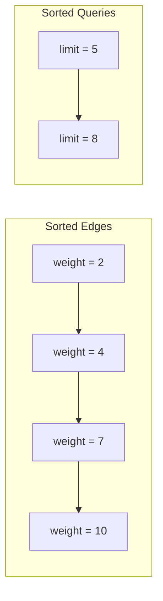
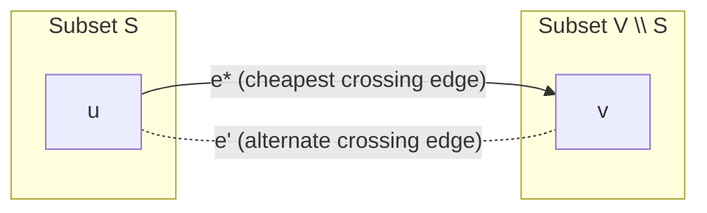

# Week 13, Day 1 (November 17, 2026)

## Today

Today we cover **Disjoint Set Union (DSU / Union-Find)** and **Minimum Spanning Trees (MST)**:
1. **DSU Fundamentals:** Path compression, union by size/rank, and amortized $O(\log n)$ operations.
2. **Problem 1: Road Construction** ([CSES 1676](https://cses.fi/problemset/task/1676)) - Base DSU with component count and maximum component size tracking.
3. **Problem 2: Checking Existence of Edge Length Limited Paths** ([LeetCode 1697](https://leetcode.com/problems/checking-existence-of-edge-length-limited-paths/)) - Applied offline DSU by sorting edges and queries monotonically.
4. **MST Fundamentals:** The Cut Property, Kruskal's algorithm via DSU, and Prim's algorithm for dense graphs.
5. **Problem 3: Road Reparation** ([CSES 1675](https://cses.fi/problemset/task/1675)) - Canonical Kruskal's MST template with connectivity verification.
6. **Problem 4: Min Cost to Connect All Points** ([LeetCode 1584](https://leetcode.com/problems/min-cost-to-connect-all-points/)) - Dense MST and algorithm selection ($O(V^2)$ Prim's vs $O(E \log E)$ Kruskal's).

You can write and test your code without local setup using the [Online IDE Guide](../misc_references/online-ide.md) ([Judge0 IDE](https://ide.judge0.com/)).

---

## Session Resources

- **Road Construction:** [CSES 1676](https://cses.fi/problemset/task/1676)
- **Checking Existence of Edge Length Limited Paths:** [LeetCode 1697](https://leetcode.com/problems/checking-existence-of-edge-length-limited-paths/)
- **Road Reparation:** [CSES 1675](https://cses.fi/problemset/task/1675)
- **Min Cost to Connect All Points:** [LeetCode 1584](https://leetcode.com/problems/min-cost-to-connect-all-points/)
- **Algorithm Animations:** [VisuAlgo DSU / Union-Find](https://visualgo.net/en/ufds) and [VisuAlgo MST](https://visualgo.net/en/mst)
- **Graph Visualizer:** [CS Academy Graph Editor](https://csacademy.com/app/graph_editor/)
- **Online IDE:** [Online IDE Guide](../misc_references/online-ide.md) ([Judge0 IDE](https://ide.judge0.com/))

---

<details>
<summary>1. Disjoint Set Union (DSU / Union-Find) Fundamentals</summary>

### The Connectivity Problem

Suppose we start with $n$ elements, each in its own separate set. We need to support two operations repeatedly:
1. `union(u, v)`: Merge the set containing $u$ with the set containing $v$.
2. `find(u)`: Return the unique representative (root) of the set containing $u$. To check if $u$ and $v$ are in the same set, check `find(u) == find(v)`.

### The Two Critical Optimizations

A naive tree implementation can degenerate into a line of length $n$, making operations $O(n)$. We prevent this using two optimizations:

1. **Path Compression (during `find`):**
   When finding the root of node $u$, reassign `parent[u]` directly to the root for every node along the path. Future lookups take $O(1)$.
2. **Union by Size or Rank (during `union`):**
   Always attach the root of the smaller tree under the root of the larger tree. This guarantees tree depth never exceeds $O(\log n)$.

Together, these two optimizations keep trees shallow, achieving an amortized time complexity of $O(\log n)$ per operation.

> [!NOTE]
> **Why Amortized $O(\log n)$?**
> An individual `find` operation might occasionally climb several hops, but that expensive traversal is self-healing:
> 1. **Tree depth is bounded by $\log n$:** When using union by size, a node's depth only increases when its component merges into an equal or larger component. This doubles the component size, meaning depth can increase at most $\log_2 n$ times.
> 2. **Path compression permanently flattens the tree:** Whenever a query pays the cost to walk up multiple levels, it reparents every visited node directly to the root forever. Paying that cost once eliminates those hops for all future queries, amortizing future operations down toward $O(1)$.

### Canonical DSU Implementation

#### Python Template

```python
class DSU:
    def __init__(self, n: int):
        self.parent = list(range(n + 1))
        self.size = [1] * (n + 1)

    def find(self, i: int) -> int:
        path = []
        while self.parent[i] != i:
            path.append(i)
            i = self.parent[i]
        for p in path:
            self.parent[p] = i
        return i

    def union(self, u: int, v: int) -> bool:
        root_u = self.find(u)
        root_v = self.find(v)
        if root_u == root_v:
            return False
        if self.size[root_u] < self.size[root_v]:
            root_u, root_v = root_v, root_u
        self.parent[root_v] = root_u
        self.size[root_u] += self.size[root_v]
        return True
```

#### C++ Template (C++20)

```cpp
struct DSU {
    vector<int> parent;
    vector<int> size;

    DSU(int n) : parent(n + 1), size(n + 1, 1) {
        iota(parent.begin(), parent.end(), 0);
    }

    int find(int i) {
        if (parent[i] == i) return i;
        return parent[i] = find(parent[i]);
    }

    bool unite(int u, int v) {
        int root_u = find(u);
        int root_v = find(v);
        if (root_u == root_v) return false;
        if (size[root_u] < size[root_v]) swap(root_u, root_v);
        parent[root_v] = root_u;
        size[root_u] += size[root_v];
        return true;
    }
};
```

</details>

---

<details>
<summary>2. Problem 1: Road Construction (CSES 1676)</summary>

### Problem Statement

There are $n$ cities and initially no roads. A total of $m$ roads are built one by one. After each road is added, output two values:
1. The total number of connected components.
2. The size of the largest connected component.

- Input: First line has integers $n$ and $m$ ($1 \le n \le 10^5$, $1 \le m \le 2 \cdot 10^5$). Then $m$ lines describe roads between cities $a$ and $b$.
- Output: Print $m$ lines, each containing the two integers.

[CSES 1676: Road Construction](https://cses.fi/problemset/task/1676)

### Starter Code (CSES 1676)

```python
import sys


def main():
    input_data = sys.stdin.read().split()
    if not input_data:
        return

    n = int(input_data[0])
    m = int(input_data[1])

    # Step 1: Initialize parent array, size array, total_components = n, max_size = 1
    # Step 2: Implement find and union
    # Step 3: For each road, union endpoints; if a merge occurs, total_components -= 1
    # Step 4: Output total_components and max_size after each road
    pass


if __name__ == "__main__":
    main()
```

### Hints

<details>
<summary>Hints</summary>

1. You start with $n$ independent components, each of size 1.
2. Whenever `union(a, b)` merges two previously disconnected components, the total component count drops by 1.
3. The new component's size is `size[root_a] + size[root_b]`. Update `max_size = max(max_size, new_size)`.
4. If `find(a) == find(b)`, the road connects two nodes already in the same component. Do not decrement the component count or modify sizes.

</details>

### Solution Idea

<details>
<summary>Solution Idea</summary>

1. Initialize `parent = [0, 1, 2, ..., n]`, `size = [1, 1, ..., 1]`, `components = n`, and `max_size = 1`.
2. For each road $(a, b)$:
   - Compute `root_a = find(a)` and `root_b = find(b)`.
   - If `root_a != root_b`:
     - Merge smaller root into larger root.
     - `size[root_a] += size[root_b]`.
     - `max_size = max(max_size, size[root_a])`.
     - `components -= 1`.
   - Output `components` and `max_size`.

</details>

### Visual Examples and Test Cases

<details>
<summary>Examples, Diagrams, and Test Inputs</summary>

- **Input:**
  ```text
  5 3
  1 2
  1 3
  4 5
  ```
- **Expected Output:**
  ```text
  4 2
  3 3
  2 3
  ```
- **Explanation:**
  - After road (1, 2): Components = 4 ({1, 2}, {3}, {4}, {5}), Max size = 2.
  - After road (1, 3): Components = 3 ({1, 2, 3}, {4}, {5}), Max size = 3.
  - After road (4, 5): Components = 2 ({1, 2, 3}, {4, 5}), Max size = 3.

</details>

### Code Links

- [Problem Explanation and Complexity Analysis](../problem_solutions/road-construction/README.md)
- [Python Solution](../problem_solutions/road-construction/solution.py)
- [C++ Solution](../problem_solutions/road-construction/solution.cpp)

</details>

---

<details>
<summary>3. Problem 2: Checking Existence of Edge Length Limited Paths (LeetCode 1697)</summary>

### Problem Statement

An undirected graph of $n$ nodes is given, with edge weights in `edgeList`. You are also given an array of queries, where each query `queries[j] = [p, q, limit]` asks: is there a path between node $p$ and node $q$ such that every edge on the path has length strictly less than `limit`?

Return a boolean array of answers corresponding to each query.

[LeetCode 1697: Checking Existence of Edge Length Limited Paths](https://leetcode.com/problems/checking-existence-of-edge-length-limited-paths/)

### The Offline Query Pattern

Standard DSU only supports adding edges, not removing them. If queries arrive with limits out of order, we would need rollbacks or path searches ($O(Q \cdot (V + E))$), which times out.

Because query answers do not depend on each other, we can process queries **offline**:
1. Sort queries ascending by `limit`.
2. Sort edges ascending by `weight`.
3. As the query limit increases, the set of allowed edges **only grows**. We use a pointer `edge_idx` to incrementally add all edges with `weight < limit` into the DSU.
4. Once all valid edges for this limit are added, answer the query with `find(p) == find(q)`.



### Correctness Proof: Monotonic Subgraph Growth (Induction)

<details>
<summary>Proof: Why Offline Sorting Is Correct</summary>

#### 1. Observation from the Problem
- Query $j = [u, v, limit]$ requires a path where every edge has $weight < limit$.
- Any edge with $weight \ge limit$ can never participate in a valid path for query $j$.
- Let $G_{L}$ denote the subgraph containing all vertices $V$ and only edges with $weight < L$.
- Answering query $j$ with limit $L$ is strictly equivalent to asking:
  $$\text{Are } u \text{ and } v \text{ in the same connected component of } G_{L}?$$
- If query limits are sorted in non-decreasing order $L_1 \le L_2 \le \dots \le L_Q$, the subgraphs grow monotonically:
  $$G_{L_1} \subseteq G_{L_2} \subseteq \dots \subseteq G_{L_Q}$$
  Edges only ever enter the graph. No edge is ever deleted.

#### 2. Step-by-Step Proof by Induction
- **Claim:** For any sorted query $k$ with limit $L_k$, the DSU state right before answering query $k$ represents the exact connected components of $G_{L_k}$.
- **Base Case ($k = 1$):**
  - We advance the edge pointer and insert every edge with $weight < L_1$.
  - By DSU properties, two vertices share a root if and only if a path of edges with weight $< L_1$ connects them.
  - Thus, `find(u) == find(v)` correctly answers query 1.
- **Inductive Step:**
  - Assume the DSU correctly reflects all connected components of $G_{L_k}$.
  - For query $k + 1$ with limit $L_{k+1} \ge L_k$, we advance the edge pointer and insert only the new edges satisfying $L_k \le weight < L_{k+1}$.
  - Merging these edges updates the DSU to reflect all components of $G_{L_{k+1}}$.
  - Because edges are sorted, no edge with $weight \ge L_{k+1}$ has been inserted.
  - Therefore, `find(u) == find(v)` correctly answers query $k + 1$.
- **Conclusion:** By induction, every query is answered correctly in a single forward pass without rolling back DSU operations.

</details>

### Starter Code (LeetCode 1697)

```python
class Solution:
    def distanceLimitedPathsExist(
        self, n: int, edgeList: list[list[int]], queries: list[list[int]]
    ) -> list[bool]:
        # Step 1: Sort edges by weight ascending
        # Step 2: Index queries and sort by limit ascending
        # Step 3: Advance edge pointer and union edges with weight < limit
        # Step 4: Record find(p) == find(q) into answer at original query index
        pass
```

### Hints

<details>
<summary>Hints</summary>

1. You do not need to answer queries in the order they are provided.
2. If you sort queries by limit, edges with weight $< limit$ only need to be added once across the entire algorithm.
3. Keep track of each query's original index so you can reconstruct the final boolean answer array in the correct order.
4. An edge with weight equal to limit cannot be used (the problem requires strictly less than).

</details>

### Solution Idea

<details>
<summary>Solution Idea</summary>

1. Sort `edgeList` ascending by edge weight.
2. Pair each query with its original index: `(p, q, limit, orig_idx)` and sort ascending by `limit`.
3. Initialize DSU for $n$ vertices and an edge pointer `edge_idx = 0`.
4. For each query `(p, q, limit, orig_idx)`:
   - While `edge_idx < len(edgeList)` and `edgeList[edge_idx].weight < limit`:
     - Union `edgeList[edge_idx].u` and `edgeList[edge_idx].v`.
     - `edge_idx += 1`.
   - `ans[orig_idx] = (find(p) == find(q))`.
5. Return `ans`.

</details>

### Visual Examples and Test Cases

<details>
<summary>Examples, Diagrams, and Test Inputs</summary>

- **Example:**
  - $n = 3$, `edgeList = [[0, 1, 2], [1, 2, 4], [2, 0, 8], [1, 0, 16]]`
  - `queries = [[0, 1, 2], [0, 2, 5]]`
- **Expected Output:**
  - `[false, true]`
- **Explanation:**
  - Query 1: Need path between 0 and 1 with all edges $< 2$. Allowed edges: none. $0$ and $1$ are not connected. Result: `false`.
  - Query 2: Need path between 0 and 2 with all edges $< 5$. Allowed edges: $(0, 1)$ with weight 2 and $(1, 2)$ with weight 4. Path $0 - 1 - 2$ connects 0 and 2. Result: `true`.

</details>

### Code Links

- [Problem Explanation and Complexity Analysis](../problem_solutions/checking-existence-of-edge-length-limited-paths/README.md)
- [Python Solution](../problem_solutions/checking-existence-of-edge-length-limited-paths/solution.py)
- [C++ Solution](../problem_solutions/checking-existence-of-edge-length-limited-paths/solution.cpp)

</details>

---

<details>
<summary>4. Minimum Spanning Trees (MST) Fundamentals</summary>

### What is a Minimum Spanning Tree?

Given a connected, weighted, undirected graph $G = (V, E)$, a **Spanning Tree** is a subgraph that connects all $V$ vertices using exactly $V - 1$ edges with no cycles.

A **Minimum Spanning Tree (MST)** is a spanning tree whose sum of edge weights is minimized.

### The Cut Property (Exchange Argument Foundation)

Let $S$ be any non-empty proper subset of vertices, and let $V \setminus S$ be the remaining vertices. The partition $(S, V \setminus S)$ is called a **cut**. An edge crosses the cut if one endpoint lies in $S$ and the other lies in $V \setminus S$.



<details>
<summary>Proof: The Cut Property via Exchange Argument</summary>

#### 1. Observation from the Problem
- Any valid spanning tree must connect all vertices in the graph.
- Therefore, every spanning tree **must contain at least one edge crossing the cut** $(S, V \setminus S)$ to bridge the two partitions.
- If there are multiple edges crossing the cut, which one should we choose? Greedily selecting the cheapest crossing edge $e^*$ seems optimal, but we must prove it never eliminates the possibility of achieving a globally minimal spanning tree.

#### 2. Step-by-Step Proof by Exchange Argument
- **Claim:** Let $e^* = (u, v)$ be a minimum-weight edge crossing cut $(S, V \setminus S)$. Then $e^*$ belongs to at least one Minimum Spanning Tree.
- **Step 1 (Assume for Contradiction):**
  - Suppose that no MST contains $e^*$.
  - Let $T$ be an optimal MST of the graph. By our assumption, $e^* \notin T$.
- **Step 2 (The Cycle in a Spanning Tree):**
  - Because $T$ is already a connected spanning tree, adding $e^*$ to $T$ must create a unique simple cycle $C$.
- **Step 3 (Crossing Back Across the Cut):**
  - Edge $e^*$ has one endpoint $u \in S$ and the other endpoint $v \in V \setminus S$.
  - Traversing the cycle $C$ from $v$ back to $u$ starts in $V \setminus S$ and ends in $S$.
  - Therefore, cycle $C$ must cross the cut $(S, V \setminus S)$ at least once more using some other edge $e' = (u', v') \ne e^*$.
- **Step 4 (The Exchange):**
  - Construct a new subgraph $T'$ by removing $e'$ and inserting $e^*$:
    $$T' = (T \setminus \{e'\}) \cup \{e^*\}$$
  - Since $e'$ was on cycle $C$, removing it breaks the cycle while leaving all vertices connected.
  - $T'$ has $V - 1$ edges, connects all vertices, and contains no cycles. Thus, $T'$ is a valid spanning tree.
- **Step 5 (Cost Comparison):**
  - Compare the total weights:
    $$cost(T') = cost(T) - cost(e') + cost(e^*)$$
  - Since $e^*$ was chosen as the *minimum-weight* edge crossing the cut, we know $cost(e^*) \le cost(e')$.
  - This implies:
    $$cost(T') \le cost(T)$$
  - But $T$ is an MST (its cost is already minimal), so $cost(T')$ cannot be strictly less than $cost(T)$.
  - Therefore, $cost(T') = cost(T)$.
- **Conclusion:**
  - $T'$ is an optimal Minimum Spanning Tree that includes $e^*$.
  - This completes the exchange argument: greedily picking the cheapest edge crossing any cut is always safe and optimal.

</details>

---

### Kruskal's vs Prim's: Choosing the Right Tool

| Feature | Kruskal's Algorithm | Prim's Algorithm (Dense) |
| :--- | :--- | :--- |
| **Strategy** | Global greedy: sort edges, add via DSU | Local greedy: expand tree one vertex at a time |
| **Data Structure** | Disjoint Set Union (DSU) | 1D distance array (`min_dist[v]`) |
| **Time Complexity** | $O(E \log E)$ | $O(V^2)$ |
| **Space Complexity** | $O(E + V)$ | $O(V)$ |
| **Best Used For** | **Sparse graphs** ($E \approx V$) or pre-given edge lists | **Dense graphs** ($E \approx V^2 / 2$) or complete graphs |

</details>

---

<details>
<summary>5. Problem 3: Road Reparation (CSES 1675)</summary>

### Problem Statement

There are $n$ cities and $m$ roads between them. Each road has an associated repair cost. Determine the minimum total cost to repair a subset of roads such that all cities are mutually reachable. If it is impossible to connect all cities, print `IMPOSSIBLE`.

- Input: First line has integers $n$ and $m$ ($1 \le n \le 10^5$, $1 \le m \le 2 \cdot 10^5$). Then $m$ lines describe roads: cities $a, b$ and repair cost $c$ ($1 \le c \le 10^9$).
- Output: Print one integer: minimum total repair cost, or `IMPOSSIBLE`.

[CSES 1675: Road Reparation](https://cses.fi/problemset/task/1675)

### Proof of Correctness: Kruskal's Algorithm (Induction and Contradiction)

<details>
<summary>Proof: Why Kruskal's Algorithm Finds an MST</summary>

#### 1. Observation from the Problem
- Kruskal's processes edges in ascending order of cost.
- If an edge connects two already-connected vertices ($find(u) == find(v)$), it discards it.
- If an edge connects two distinct components ($find(u) \ne find(v)$), it greedily includes it in the tree.
- We must prove two things:
  1. Why is it safe to discard cycle-forming edges?
  2. Why is the accepted edge guaranteed to be part of an optimal MST?

#### 2. Why Discarding Cycle Edges is Optimal (Proof by Contradiction)
- Suppose edge $e = (u, v)$ connects vertices $u$ and $v$ that already share a path in our accepted edge set.
- All edges along that existing path were accepted earlier, so each has $weight \le weight(e)$.
- If we accepted $e$, it would create a cycle where $e$ is the heaviest (or tied for heaviest) edge on that cycle.
- By the Cycle Property of MSTs, the strictly heaviest edge on any cycle can never belong to an MST (swapping it with any other edge on the cycle would reduce total cost).
- Therefore, $e$ can be safely discarded without losing any optimal MST.

#### 3. Why Accepting Edges is Safe (Inductive Cut Application)
- **Claim:** At every step, the set of edges $T_k$ accepted by Kruskal's is a subset of some MST.
- **Base Case ($k = 0$):** $T_0 = \emptyset$. The empty set is trivially a subset of every MST.
- **Inductive Step:**
  - Assume $T_k$ is a subset of some MST $T^*$.
  - Kruskal's selects the next cheapest edge $e = (u, v)$ with $find(u) \ne find(v)$.
  - Let $C_u$ be the set of vertices in the connected component of $u$ within $(V, T_k)$.
  - Consider the cut $(C_u, V \setminus C_u)$.
  - Because $v \notin C_u$, edge $e$ crosses this cut.
  - Can there be any edge crossing $(C_u, V \setminus C_u)$ with strictly smaller weight than $e$?
    - No! Any cheaper edge in the entire graph was already examined before $e$.
    - If a cheaper crossing edge existed, it would have been accepted or discarded. It could not have been discarded (since $C_u$ was not yet connected to $V \setminus C_u$), so it would have been accepted, meaning $v$ would already be in $C_u$, a contradiction.
  - Thus, $e$ is the **minimum-weight edge in the entire graph crossing the cut** $(C_u, V \setminus C_u)$.
  - By the **Cut Property**, $e$ belongs to an MST that extends $T_k$. Therefore, $T_{k+1} = T_k \cup \{e\}$ is also a subset of an MST.
- **Termination:**
  - The algorithm stops when $n - 1$ edges have been accepted. Because no cycles were ever created, the result is a connected acyclic graph on $n$ vertices with $n - 1$ edges.
  - By induction, this spanning tree is an optimal Minimum Spanning Tree.
  - If fewer than $n - 1$ edges are accepted after checking all $m$ edges, the graph is disconnected, and the algorithm correctly outputs `IMPOSSIBLE`.

</details>

### Starter Code (CSES 1675)

```python
import sys


def main():
    input_data = sys.stdin.read().split()
    if not input_data:
        return

    n = int(input_data[0])
    m = int(input_data[1])

    # Step 1: Read and sort all m edges by cost ascending
    # Step 2: Use DSU to greedily include non-cycle edges
    # Step 3: Accumulate total_cost and count edges_added
    # Step 4: If edges_added == n - 1, print total_cost; otherwise print IMPOSSIBLE
    pass


if __name__ == "__main__":
    main()
```

### Hints

<details>
<summary>Hints</summary>

1. Sort all edges ascending by repair cost.
2. Initialize a DSU with $n$ elements, `edges_added = 0`, and `total_cost = 0`.
3. Loop through sorted edges: if `union(u, v)` succeeds, add the cost to `total_cost` and increment `edges_added`.
4. Stop early once `edges_added == n - 1`.
5. Edge costs can exceed $2^{31} - 1$. In C++, use `long long` for the total cost to avoid integer overflow.

</details>

### Solution Idea

<details>
<summary>Solution Idea</summary>

1. Read all edges $(u, v, cost)$ into a list and sort ascending by $cost$.
2. Initialize DSU parent and rank arrays.
3. For each edge $(u, v, cost)$:
   - If `union(u, v)` returns `true` (nodes were in distinct components):
     - `total_cost += cost`
     - `edges_added += 1`
     - If `edges_added == n - 1`, break early.
4. If `edges_added == n - 1`, print `total_cost`. Otherwise, print `IMPOSSIBLE`.

</details>

### Visual Examples and Test Cases

<details>
<summary>Examples, Diagrams, and Test Inputs</summary>

- **Input:**
  ```text
  5 6
  1 2 3
  2 3 5
  2 4 2
  3 4 8
  5 1 7
  5 4 4
  ```
- **Expected Output:**
  ```text
  14
  ```
- **Explanation:**
  - Selected edges in sorted order:
    1. (2, 4) with cost 2
    2. (1, 2) with cost 3
    3. (5, 4) with cost 4
    4. (2, 3) with cost 5
  - Total edges added: 4 ($n - 1$). Total cost: $2 + 3 + 4 + 5 = 14$.

</details>

### Code Links

- [Problem Explanation and Complexity Analysis](../problem_solutions/road-reparation/README.md)
- [Python Solution](../problem_solutions/road-reparation/solution.py)
- [C++ Solution](../problem_solutions/road-reparation/solution.cpp)

</details>

---

<details>
<summary>6. Problem 4: Min Cost to Connect All Points (LeetCode 1584)</summary>

### Problem Statement

You are given an array `points` representing integer coordinates of some points on a 2D-plane, where `points[i] = [xi, yi]`.

The cost of connecting two points `[xi, yi]` and `[xj, yj]` is the Manhattan distance between them: $|x_i - x_j| + |y_i - y_j|$.

Return the minimum cost to make all points connected.

[LeetCode 1584: Min Cost to Connect All Points](https://leetcode.com/problems/min-cost-to-connect-all-points/)

### Proof of Correctness: Prim's Algorithm via Cut Property (Induction)

<details>
<summary>Proof: Why Dense Prim's Finds an MST</summary>

#### 1. Observation from the Problem
- In complete and dense graphs, Prim's algorithm grows a single tree $S$ one vertex at a time starting from an arbitrary vertex (e.g. vertex 0).
- At any step, let $S$ be the set of vertices already added to the MST, and let $V \setminus S$ be the remaining unvisited vertices.
- The algorithm greedily selects the unvisited vertex $u \in V \setminus S$ that minimizes `min_dist[u]`, which represents the shortest distance from $u$ to any vertex in $S$.

#### 2. Step-by-Step Proof by Induction on Added Vertices
- **Claim:** Every edge added by Prim's algorithm belongs to an optimal MST.
- **Base Case:** The initial set $S = \{0\}$ trivially has 0 edges, which is a subset of an MST.
- **Inductive Step:**
  - Assume the tree on vertices $S$ with edges $T_{step}$ is a subset of some MST.
  - Consider the cut $(S, V \setminus S)$ separating the current tree from all unvisited vertices.
  - The algorithm identifies vertex $u \in V \setminus S$ with the minimum `min_dist[u]`.
  - The edge $(p, u)$ connecting $u$ to its closest neighbor $p \in S$ is, by construction, the **minimum-weight edge crossing the cut** $(S, V \setminus S)$.
  - By the **Cut Property**, the minimum-weight edge crossing any cut belongs to an MST extending $T_{step}$.
  - Therefore, adding edge $(p, u)$ and vertex $u$ maintains the property that the edges are a subset of an MST.
- **Termination:**
  - After $V - 1$ steps, all $V$ vertices belong to $S$. The resulting tree contains $V - 1$ edges, connects all vertices, and is acyclic.
  - By induction, it is a valid Minimum Spanning Tree.

</details>

### Why Dense Prim's Beats Kruskal's Here

Every point can connect to every other point, forming an implicit complete graph:
- $V \le 1000$ points.
- $E = \frac{V(V - 1)}{2} \approx 5 \cdot 10^5$ edges.

If we use Kruskal's algorithm:
- We must materialize all $500{,}000$ edges in memory ($O(V^2)$ space).
- We must sort $500{,}000$ edges, taking $O(V^2 \log V)$ operations.

If we use **Dense Prim's** (without a heap):
- Maintain an array `min_dist[v]` of size $V = 1000$ recording the minimum distance to the current tree.
- In each of $V$ steps, find the unvisited node with minimum distance ($O(V)$ scan) and update all neighbor distances ($O(V)$ scan).
- Total time is strictly $O(V^2)$ operations ($10^6$ operations, runs in $< 50$ ms).
- Auxiliary space is strictly $O(V)$ (no edges stored in memory).

### Starter Code (LeetCode 1584)

```python
class Solution:
    def minCostConnectPoints(self, points: list[list[int]]) -> int:
        n = len(points)
        # Step 1: Initialize min_dist array to infinity, min_dist[0] = 0
        # Step 2: In each step, pick unvisited node u with minimum min_dist
        # Step 3: Mark u visited and accumulate min_dist[u]
        # Step 4: Relax distances min_dist[v] = min(min_dist[v], manhattan(u, v))
        pass
```

### Hints

<details>
<summary>Hints</summary>

1. Manhattan distance between $(x_1, y_1)$ and $(x_2, y_2)$ is $|x_1 - x_2| + |y_1 - y_2|$.
2. This is an unrooted MST on a complete graph with $n$ vertices.
3. Because $E \approx V^2 / 2$, Kruskal's algorithm spends unnecessary overhead generating and sorting an explicit edge list.
4. Prim's algorithm tracks distance from each vertex to the growing tree. You do not need a priority queue: an array search over $n$ elements takes $O(n)$ time per step.

</details>

### Solution Idea

<details>
<summary>Solution Idea</summary>

1. Create `min_dist = [inf] * n`, `min_dist[0] = 0`, and `in_mst = [False] * n`.
2. For step from $0$ to $n - 1$:
   - Scan to find unvisited $u$ with smallest `min_dist[u]`.
   - Set `in_mst[u] = True` and `total_cost += min_dist[u]`.
   - For all unvisited $v$, update `min_dist[v] = min(min_dist[v], manhattan(points[u], points[v]))`.
3. Return `total_cost`.

</details>

### Visual Examples and Test Cases

<details>
<summary>Examples, Diagrams, and Test Inputs</summary>

- **Example:**
  - `points = [[0, 0], [2, 2], [3, 10], [5, 2], [7, 0]]`
- **Expected Output:**
  - `20`
- **Explanation:**
  - Connect point 0 to point 1 (cost 4).
  - Connect point 1 to point 3 (cost 3).
  - Connect point 3 to point 4 (cost 4).
  - Connect point 1 to point 2 (cost 9).
  - Total minimum cost: $4 + 3 + 4 + 9 = 20$.

</details>

### Code Links

- [Problem Explanation and Complexity Analysis](../problem_solutions/min-cost-to-connect-all-points/README.md)
- [Python Solution](../problem_solutions/min-cost-to-connect-all-points/solution.py)
- [C++ Solution](../problem_solutions/min-cost-to-connect-all-points/solution.cpp)

</details>
