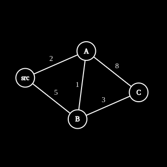
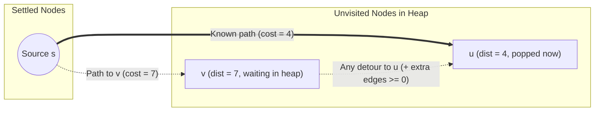
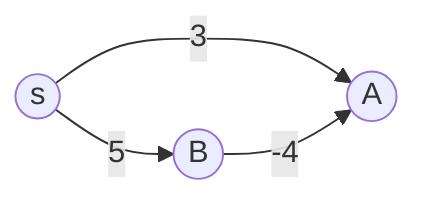
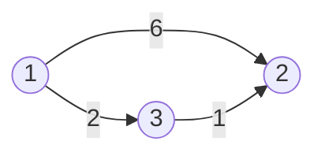
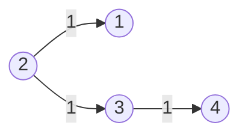

# Week 13, Day 2 (November 19, 2026)

## Today

Today we explore **Dijkstra's Algorithm** for Single-Source Shortest Paths (SSSP):
1. **Dijkstra Fundamentals:** Greedy state expansion using a min-heap priority queue ($O((V + E) \log V)$).
2. **The Correctness Proof:** How non-negative edge weights establish the monotonic distance invariant, proved step by step via contradiction and induction.
3. **Problem 1: Shortest Routes I** ([CSES 1671](https://cses.fi/problemset/task/1671)) - Canonical SSSP template on directed graphs with 64-bit distance tracking.
4. **Problem 2: Network Delay Time** ([LeetCode 743](https://leetcode.com/problems/network-delay-time/)) - Simultaneous broadcast propagation and reachability verification.
5. **Problem 3: Path with Minimum Effort** ([LeetCode 1631](https://leetcode.com/problems/path-with-minimum-effort/)) - Applied Minimax Dijkstra on 2D implicit grid graphs.

You can write and test your code without local setup using the [Online IDE Guide](../misc_references/online-ide.md) ([Judge0 IDE](https://ide.judge0.com/)).

---

## Session Resources

- **Shortest Routes I:** [CSES 1671](https://cses.fi/problemset/task/1671)
- **Network Delay Time:** [LeetCode 743](https://leetcode.com/problems/network-delay-time/)
- **Path with Minimum Effort:** [LeetCode 1631](https://leetcode.com/problems/path-with-minimum-effort/)
- **Algorithm Animations:** [VisuAlgo Single-Source Shortest Paths](https://visualgo.net/en/sssp)
- **Graph Visualizer:** [CS Academy Graph Editor](https://csacademy.com/app/graph_editor/)
- **Online IDE:** [Online IDE Guide](../misc_references/online-ide.md) ([Judge0 IDE](https://ide.judge0.com/))

---

<details>
<summary>1. Dijkstra's Algorithm Fundamentals and Mechanics</summary>

### The Problem

Given a directed or undirected graph with **non-negative edge weights** and a source vertex $s$, find the shortest path from $s$ to all other vertices.

### The Mental Model: Concentric Ripple Expansion

Think of Dijkstra as Breadth-First Search (BFS) where edges have varying lengths:
- In unweighted BFS, edges take 1 step, so a standard queue expands in uniform concentric layers: distance 1, distance 2, distance 3.
- In weighted graphs with non-negative weights, time along edges varies. A priority queue (min-heap) allows us to always process the next event that happens earliest in time.



Path to $B$:
- Direct edge $s \to B$ costs 5.
- Path via $A$: $s \to A \to B$ costs $2 + 1 = 3$.
Dijkstra relaxes edges through the cheapest intermediate vertex first, discovering the optimal path of cost 3 before considering longer paths.

---

### Core Implementation Pattern

#### Python Template

```py
import heapq


def dijkstra(num_nodes: int, adj_list: list[list[tuple[int, int]]], source: int):
    cost_to_reach = [float("inf") for _ in range(num_nodes + 1)]
    cost_to_reach[source] = 0

    # Priority queue (min-heap) stores pairs of (cost, node)
    pq = [(0, source)]

    while pq:
        cur_node_cost, cur_node = heapq.heappop(pq)

        # Skip stale entries pushed before a shorter route was found
        if cur_node_cost > cost_to_reach[cur_node]:
            continue

        for node, edge_cost in adj_list[cur_node]:
            new_cost = cur_node_cost + edge_cost
            if new_cost < cost_to_reach[node]:
                cost_to_reach[node] = new_cost
                heapq.heappush(pq, (new_cost, node))

    return cost_to_reach
```

#### C++20 Template (Clean Struct with Custom Comparator)

```cpp
#include <iostream>
#include <queue>
#include <vector>

using namespace std;

struct Edge {
    int to;
    long long weight;

    // Custom comparator for min-heap (smaller distance pops first)
    bool operator<(const Edge& other) const {
        return weight > other.weight;
    }
};

vector<long long> dijkstra(int num_nodes, const vector<vector<Edge>>& adj, int source) {
    const long long INF = 1e18;
    vector<long long> dist(num_nodes + 1, INF);
    priority_queue<Edge> pq;

    dist[source] = 0;
    pq.push({source, 0});

    while (!pq.empty()) {
        auto [node, curr_dist] = pq.top();
        pq.pop();

        if (curr_dist > dist[node]) {
            continue;
        }

        for (const auto& edge : adj[node]) {
            if (dist[node] + edge.weight < dist[edge.to]) {
                dist[edge.to] = dist[node] + edge.weight;
                pq.push({edge.to, dist[edge.to]});
            }
        }
    }

    return dist;
}
```

</details>

---

<details>
<summary>2. Correctness Intuition: Why Detours Cannot Beat Dijkstra</summary>

### Why Does Dijkstra Work?

Dijkstra is fundamentally a **greedy algorithm**. It claims that the moment a vertex $u$ is popped from the min-heap with distance $d$, that distance is **finalized and guaranteed optimal**.

Why can't some complicated detour through unvisited vertices reach $u$ with a smaller cost later?



Look at the choice the algorithm faces:
1. **We consider the minimum first**: The min-heap pops $u$ because its tentative distance ($dist[u] = 4$) is the smallest in the queue.
2. **Every other unexplored option is already more expensive**: Any unvisited node $v$ still in the heap already has $dist[v] \ge dist[u]$ (here $7 \ge 4$), or else it would have been popped before $u$.
3. **Detours can only add cost**: All edge weights are non-negative ($w \ge 0$). Because path costs are monotonically non-decreasing, extending a path through $v$ can only add on top of what we already have:
   $$\text{cost of detour} = dist[v] + \text{extra edges} \ge 7 + 0 = 7 \ge 4$$
   A detour that already starts at 7 can never reach $u$ with a cost under 4.

Therefore, the moment $u$ comes out of the min-heap, no future detour can ever beat $dist[u]$. Its distance is locked in.

---

### Why Negative Edge Weights Break Dijkstra

If a graph contains an edge with negative weight $w(a, b) < 0$, extending a path can **decrease** its total cost.

Consider this counterexample:


1. Source is $s$. Min-heap contains $(3, A)$ and $(5, B)$.
2. Dijkstra greedily pops $A$ first with distance 3 and declares $dist[A] = 3$ finalized.
3. Later, Dijkstra pops $B$ with distance 5, and relaxes edge $B \to A$:
   $$dist[B] + (-4) = 5 - 4 = 1$$
4. The true shortest path to $A$ is $s \to B \to A$ with cost 1, but Dijkstra had already finalized $A$ at cost 3!
5. This failure demonstrates why non-negative weights are a non-negotiable prerequisite for Dijkstra's algorithm.

</details>

---

<details>
<summary>3. Problem 1: Shortest Routes I (CSES 1671)</summary>

### Problem Statement

There are $n$ cities and $m$ flight connections. Your task is to determine the length of the shortest route from city 1 to every city $1, 2, \dots, n$.

- Input: First line has integers $n$ and $m$ ($1 \le n \le 10^5$, $1 \le m \le 2 \cdot 10^5$). Then $m$ lines describe flights: cities $a, b$ and flight length $c$ ($1 \le c \le 10^9$).
- Output: Print $n$ integers: the shortest route from city 1 to cities $1, 2, \dots, n$.

[CSES 1671: Shortest Routes I](https://cses.fi/problemset/task/1671)

### Starter Code (CSES 1671)

```py
import heapq
import sys


def main():
    input = sys.stdin.readline  # to avoid TLE on CSES
    n, m = map(int, input().split())

    adj_list = [list() for _ in range(n + 1)]
    for _ in range(m):
        a, b, c = map(int, input().split())
        adj_list[a].append((b, c))

    # Step 2: Initialize cost_to_reach with infinity, cost_to_reach[1] = 0
    # Step 3: Run Dijkstra with min-heap
    # Step 4: Print all shortest distances separated by spaces
    pass


if __name__ == "__main__":
    main()
```

### Hints

<details>
<summary>Hints</summary>

1. All edge weights are positive, which means standard Dijkstra's algorithm applies directly.
2. In C++, flight lengths can accumulate up to $2 \cdot 10^{14}$. Always use 64-bit integers (`long long`) to prevent overflow.
3. Multiple edges may exist between the same pair of cities. Dijkstra handles parallel edges automatically by relaxing the cheaper edge first.
4. Don't forget the stale entry check: `if cur_node_cost > cost_to_reach[cur_node]: continue`. Without it, you do redundant relaxation work.

</details>

### Solution Idea

<details>
<summary>Solution Idea</summary>

1. Build an adjacency list `adj_list` where `adj_list[cur_node]` stores pairs `(node, edge_cost)`.
2. Initialize `cost_to_reach = [float("inf") for _ in range(n + 1)]` and set `cost_to_reach[1] = 0`.
3. Push `(0, 1)` into a min-heap `pq`.
4. While `pq` is not empty:
   - Pop `(cur_node_cost, cur_node)`. If `cur_node_cost > cost_to_reach[cur_node]`, continue.
   - For each `(node, edge_cost)` in `adj_list[cur_node]`:
     - `new_cost = cur_node_cost + edge_cost`
     - If `new_cost < cost_to_reach[node]`:
       - `cost_to_reach[node] = new_cost`
       - Push `(new_cost, node)` into `pq`.
5. Print `cost_to_reach[1], cost_to_reach[2], ..., cost_to_reach[n]`.

</details>

### Visual Examples and Test Cases

<details>
<summary>Examples, Diagrams, and Test Inputs</summary>



- **Input:**
  ```text
  3 3
  1 2 6
  1 3 2
  3 2 1
  ```
- **Expected Output:**
  ```text
  0 3 2
  ```
- **Explanation:**
  - City 1 to City 1: Distance is 0.
  - City 1 to City 3: Direct edge costs 2.
  - City 1 to City 2: Direct edge costs 6, but path $1 \to 3 \to 2$ costs $2 + 1 = 3$.

</details>

### Code Links

- [Problem Explanation and Complexity Analysis](../problem_solutions/shortest-routes-i/README.md)
- [Python Solution](../problem_solutions/shortest-routes-i/solution.py)
- [C++ Solution](../problem_solutions/shortest-routes-i/solution.cpp)

</details>

---

<details>
<summary>4. Problem 2: Network Delay Time (LeetCode 743)</summary>

### Problem Statement

You are given a network of $n$ nodes labeled from $1$ to $n$. You are also given `times`, a list of directed edges `times[i] = [ui, vi, wi]`, where $w_i$ is the travel time from $u_i$ to $v_i$.

We send a signal from a given node $k$. Return the minimum time it takes for all $n$ nodes to receive the signal. If it is impossible for all $n$ nodes to receive the signal, return `-1`.

[LeetCode 743: Network Delay Time](https://leetcode.com/problems/network-delay-time/)

### Starter Code (LeetCode 743)

```py
import heapq


class Solution:
    def networkDelayTime(
        self, times: list[list[int]], n: int, k: int
    ) -> int:
        num_nodes = n
        source = k
        # Step 1: Build adjacency list for 1-indexed nodes
        # Step 2: Run Dijkstra starting from source node
        # Step 3: Find maximum distance among all nodes 1 to num_nodes
        # Step 4: If any node has distance infinity, return -1; else return max distance
        pass
```

### Hints

<details>
<summary>Hints</summary>

1. Signals spread concurrently along all paths. The moment a node receives the signal is its shortest path distance from the source node.
2. The network is fully notified when the last reachable node receives the signal: $\max_{1 \le i \le n} dist[i]$.
3. If any node has distance $\infty$ after Dijkstra terminates, the graph is not fully reachable from the source; return `-1`.

</details>

### Solution Idea

<details>
<summary>Solution Idea</summary>

1. Construct directed adjacency list `adj_list` of size `n + 1`.
2. Initialize `cost_to_reach = [INF for _ in range(n + 1)]` and `cost_to_reach[k] = 0`.
3. Push `(0, k)` into min-heap `pq`.
4. Run standard Dijkstra to compute shortest paths to all nodes.
5. Take `max_cost = max(cost_to_reach[1:])`.
6. Return `max_cost` if `max_cost < INF` else `-1`.

</details>

### Visual Examples and Test Cases

<details>
<summary>Examples, Diagrams, and Test Inputs</summary>



- **Example 1:**
  - `times = [[2, 1, 1], [2, 3, 1], [3, 4, 1]], n = 4, k = 2`
  - **Expected Output:** `2`
  - **Explanation:** Node 2 reaches node 1 at time 1, node 3 at time 1, and node 4 at time $1 + 1 = 2$. Maximum time is 2.
- **Example 2:**
  - `times = [[1, 2, 1]], n = 2, k = 2`
  - **Expected Output:** `-1`
  - **Explanation:** Signal starts at node 2, but there are no outgoing edges from node 2 to node 1. Node 1 is unreachable.

</details>

### Code Links

- [Problem Explanation and Complexity Analysis](../problem_solutions/network-delay-time/README.md)
- [Python Solution](../problem_solutions/network-delay-time/solution.py)
- [C++ Solution](../problem_solutions/network-delay-time/solution.cpp)

</details>

---

<details>
<summary>5. Problem 3: Path with Minimum Effort (LeetCode 1631)</summary>

### Problem Statement

You are a hiker preparing for an upcoming hike. You are given `heights`, a 2D array of size `rows x columns`, where `heights[row][col]` represents the height of cell `(row, col)`.

A route's **effort** is the maximum absolute difference in heights between two consecutive cells of the route.

Return the minimum effort required to travel from the top-left cell `(0, 0)` to the bottom-right cell `(rows - 1, columns - 1)`.

[LeetCode 1631: Path with Minimum Effort](https://leetcode.com/problems/path-with-minimum-effort/)

### Beyond Sum of Weights: Minimax Dijkstra

In standard Dijkstra, distances add up: $dist[v] = dist[u] + weight$.
Here, the metric is **minimax bottleneck**:
$$effort[v] = \max(effort[u], |height[u] - height[v]|)$$

Does Dijkstra work here?
**Yes!** Dijkstra works on any path metric that is monotonically non-decreasing along paths:
$$\max(effort[u], \Delta) \ge effort[u]$$
Taking another step can never reduce the maximum effort accumulated so far. The greedy choice invariant holds: whenever cell `(row, col)` is popped from the min-heap, its effort is finalized!

### Starter Code (LeetCode 1631)

```py
import heapq


class Solution:
    def minimumEffortPath(self, heights: list[list[int]]) -> int:
        rows = len(heights)
        cols = len(heights[0])
        # Step 1: Initialize dist 2D matrix with infinity, dist[0][0] = 0
        # Step 2: Min-heap stores tuples of (effort, row, col)
        # Step 3: When target cell (rows - 1, cols - 1) is popped, return its effort immediately
        # Step 4: For adjacent cardinal neighbors, next_effort = max(effort, abs(height_diff))
        pass
```

### Hints

<details>
<summary>Hints</summary>

1. Model the grid as a graph where each cell connects to its 4 cardinal orthogonal neighbors.
2. The edge weight between cells is the absolute height difference: $|heights[row][col] - heights[next\_row][next\_col]|$.
3. When relaxing an edge, the new path effort is $\max(current\_effort, edge\_weight)$.
4. Push `(new_effort, next_row, next_col)` into the min-heap if `new_effort < dist[next_row][next_col]`.
5. Because Dijkstra pops elements in increasing order of effort, the first time you pop `(rows - 1, cols - 1)`, that effort is optimal!

</details>

### Solution Idea

<details>
<summary>Solution Idea</summary>

1. Initialize `dist = [[inf] * cols for _ in range(rows)]` and `dist[0][0] = 0`.
2. Push `(0, 0, 0)` (representing `(effort, row, col)`) into min-heap `pq`.
3. While `pq` is not empty:
   - Pop `(effort, row, col)`.
   - If `row == rows - 1 and col == cols - 1`, return `effort`.
   - If `effort > dist[row][col]`, continue.
   - For each cardinal direction `(row_offset, col_offset)`:
     - Check bounds `0 <= next_row < rows and 0 <= next_col < cols`.
     - Calculate `next_effort = max(effort, abs(heights[row][col] - heights[next_row][next_col]))`.
     - If `next_effort < dist[next_row][next_col]`:
       - `dist[next_row][next_col] = next_effort`
       - Push `(next_effort, next_row, next_col)` into `pq`.
4. Return 0.

</details>

### Visual Examples and Test Cases

<details>
<summary>Examples, Diagrams, and Test Inputs</summary>

- **Example 1:**
  - `heights = [[1, 2, 2], [3, 8, 2], [5, 3, 5]]`
  - **Expected Output:** `2`
  - **Explanation:** Route `(0, 0) -> (0, 1) -> (0, 2) -> (1, 2) -> (2, 2)` has height differences `[1, 0, 0, 3]`. Wait, the route `(0, 0) -> (1, 0) -> (2, 0) -> (2, 1) -> (2, 2)` has heights `[1, 3, 5, 3, 5]`, where each step has difference 2. Maximum absolute difference is 2.
- **Example 2:**
  - `heights = [[1, 2, 3], [3, 8, 4], [5, 3, 5]]`
  - **Expected Output:** `1`
  - **Explanation:** Route `(0, 0) -> (0, 1) -> (0, 2) -> (1, 2) -> (2, 2)` has heights `[1, 2, 3, 4, 5]`, where each step has absolute difference 1.

</details>

### Code Links

- [Problem Explanation and Complexity Analysis](../problem_solutions/path-with-minimum-effort/README.md)
- [Python Solution](../problem_solutions/path-with-minimum-effort/solution.py)
- [C++ Solution](../problem_solutions/path-with-minimum-effort/solution.cpp)

</details>
